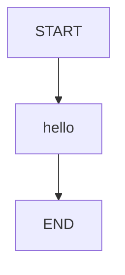

# 01 · Hello Graph：从输入到状态更新

本课用一个问候节点建立最小执行模型：输入进入状态，节点返回更新，边决定何时结束。
没有提示词、远程模型或工具调用；问候字符串来自 Java 拼接。

源码入口：[HelloGraphDemo 与完整实现](#课程源码)。

## 学习目标

- 区分图定义 `StateGraph` 与可执行图 `CompiledGraph`。
- 理解节点返回的是局部更新，而不是完整状态。
- 对照 HTTP 结果找到输入、输出和真实节点路径。
- 使用 LangGraph4j 1.9.0 的 `GraphInput`，不照搬其他框架的恢复 API。

## 原生拓扑



`START`、`END` 是引擎的起止标记；真正处理业务的是 `hello`。
本页图是按源码绘制的教学拓扑；图下可展开查看 Mermaid 源码。
获取引擎生成的 Mermaid 文本：

```bash
curl -sS http://127.0.0.1:8099/api/demos/demo01/graph
```

## 状态如何变化

| 字段 | 输入/默认值 | 节点更新 | 最终用途 |
|---|---|---|---|
| `name` | `"小明"` | 不写回 | 问候对象，保留在状态中 |
| `greeting` | 无 | `hello` 返回问候字符串 | `"你好，小明！"` |

`greeting` 没有专门的 Channel 配置，更新时使用替换语义。
`name` 不会因为节点只返回 `greeting` 而丢失。
共享 schema 可能还提供空列表或零值；它们不是本课的业务输出。

## 跟着源码读

1. `sampleInput()` 给 HTTP 目录与默认执行提供 `name`。
2. `new StateGraph<>(LearningState.SCHEMA, LearningState::new)` 指定合并规则和状态构造器。
3. `addNode` 注册节点动作，`addEdge` 注册控制流。
4. `s.inputText("name")` 校验文本并返回去掉首尾空白后的值。
5. `Map.of(...)` 是交给引擎合并的更新量，不能理解成整个状态替换。

核心动作只有一行：

```java
.addNode("hello", node_async(s ->
    Map.of("greeting", "你好，" + s.inputText("name") + "！")))
```

`node_async` 把同步动作适配到异步节点接口，并不承诺另开线程。
这里既没有并行边，也没有并发需求。

不经过 HTTP 时，原生调用可以写成：

```java
var demo = new HelloGraphDemo();
var app = demo.graph().compile();
var state = app.invoke(
    GraphInput.args(demo.sampleInput()), demo.config("hello-local")
).orElseThrow();
```

这是新执行，使用 `GraphInput.args`；`GraphInput.resume()` 留给有检查点的暂停执行。
示例中的 `hello-local` 只是本地配置标签，不是 HTTP 返回的 executionId。

## 运行第一张图

先启动项目的本地服务，再在 Bash / Git Bash 中执行：

```bash
curl -sS http://127.0.0.1:8099/api/demos
curl -sS -X POST http://127.0.0.1:8099/api/demos/demo01/run \
  -H 'Content-Type: application/json' \
  -d '{"input":{"name":"小明"}}'
```

目录响应包含各课的 `sampleInput`。`run` 会把提交字段合并到该课默认输入；
因此 `{"input":{}}` 也会运行默认问候，但首次学习建议写出完整输入。

确定性的响应子集如下，省略实际生成的 `executionId` 和其他状态字段：

```json
{
  "demoId": "demo01",
  "status": "COMPLETED",
  "state": {"name": "小明", "greeting": "你好，小明！"}
}
```

`visitedNodes` 应包含 `hello`；不要把起止标记的呈现形式当成业务契约。
顶层 `status` 描述执行生命周期，不是问候文本的一部分。
若要查询这次执行，将下面变量替换为刚刚响应里的真实 ID：

```bash
EXECUTION_ID='替换为响应中的 executionId'
curl -sS "http://127.0.0.1:8099/api/executions/$EXECUTION_ID"
```

## 边界与小实验

把输入改成 `{"input":{"name":"  小北  "}}`。
预期 `greeting` 为 `你好，小北！`，但原始 `name` 仍可保留首尾空格。
原因是 `inputText()` 返回清理后的字符串，并没有向状态提交 `name` 更新。

再试 `name` 为空串、纯空白、数字或超过 2000 字符。
这些都不满足 `LearningState.inputText()` 的约束，不应得到成功问候。
`null` 也不是“使用默认值”的表达方式；要使用默认值就省略该字段。
校验错误可能在 HTTP 层被拒绝，也可能进入执行失败路径，不能当作完成结果。

思考：如果 `hello` 返回 `Map.of()`，输入是否还存在？
答案：存在，但不会产生 `greeting`；局部更新可以为空，状态不会因此被清空。

## 易错点与能力边界

- 不要直接修改 `state.data()`；通过返回更新交给 Channel 合并。
- 不要把 Spring Boot 接口误认为图引擎必需部分；测试直接实例化课程类运行。
- 该课不涉及模型推理；确定性输出方便检查状态语义。
- HTTP 的执行 ID 由服务生成，不要复制教程里的标签假装真实 ID。

## 课程源码

源码路径：`src/main/java/com/xb/langgraph/demo01/HelloGraphDemo.java`。
以下直接包含仓库文件，不是另写一套伪实现。

<<< ../../src/main/java/com/xb/langgraph/demo01/HelloGraphDemo.java

验证依据：`CurriculumTest.sampleOutputs` 检查默认问候结果。
继续阅读[顺序编排](./02-sequence)；共享概念见[核心概念](/guide/concepts)。
