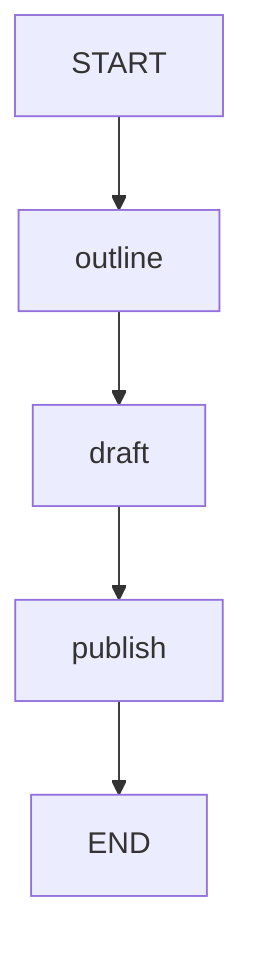

# 02 · 顺序编排：前一步输出就是下一步输入

把一个动作拆成多个节点，不只是把代码切成三段。
本课让提纲、正文、发布结果分别进入状态，从而可以定位每一步产生了什么。
“发布”仅拼接字符串，不会向网站、数据库或消息系统发送内容。

源码入口：[SequenceGraphDemo 与完整实现](#课程源码)。

## 学习目标

- 用普通边建立严格的先后依赖。
- 追踪同一状态中逐步增加的字段。
- 区分节点名称和节点产生的状态键。
- 解释为何后续节点应读取前一步结果，而不是重复读取原始输入。

## 原生拓扑



只有一条执行路径，不存在条件分流或并行。
`draft` 必须在 `outline` 的更新合并之后执行；`publish` 同理。
图中 `publish` 是节点 ID，而 `published` 才是最终状态字段。
Mermaid 围栏可作为文本阅读；原生导出接口如下：

```bash
curl -sS http://127.0.0.1:8099/api/demos/demo02/graph
```

## 状态输入、更新与输出

| 字段 | 来源 | 写入节点 | 默认执行后的值 |
|---|---|---|---|
| `topic` | 输入，默认 `LangGraph4j` | 不更新 | `LangGraph4j` |
| `outline` | 派生状态 | `outline` | `LangGraph4j：提纲` |
| `draft` | 读取 `outline` | `draft` | `LangGraph4j：提纲 → 正文` |
| `published` | 读取 `draft` | `publish` | `已发布：LangGraph4j：提纲 → 正文` |

这些字段均采用替换语义，不会自动拼接历史版本。
最终状态保留中间产物，因此检查结果时不必只看 `published`。
节点返回一个新字段，不会删除此前的 `topic` 和 `outline`。

## 逐节点解释

`outline` 对外部 `topic` 调用 `inputText()` 校验并清理空白，再附上中文冒号与“提纲”。
`draft` 读取的是校验后的 `outline`，附加箭头和“正文”。
`publish` 读取 `draft`，加上“已发布：”前缀。

```java
.addNode("outline", node_async(s ->
    Map.of("outline", s.inputText("topic") + "：提纲")))
.addNode("draft", node_async(s ->
    Map.of("draft", s.text("outline") + " → 正文")))
.addNode("publish", node_async(s ->
    Map.of("published", "已发布：" + s.text("draft"))))
```

这段代码没有读取系统时间或随机数，所以输出内容可精确断言。
顺序由边定义，不是由 `addNode` 在源码中的排列位置定义。
注册节点只是在命名动作；连接边才是在安排执行关系。

这里没有写 `status` 业务字段。
HTTP 返回的顶层 `status: COMPLETED` 来自执行层，不能据此推断课程节点写过这个键。

## 发起请求

```bash
curl -sS -X POST http://127.0.0.1:8099/api/demos/demo02/run \
  -H 'Content-Type: application/json' \
  -d '{"input":{"topic":"LangGraph4j"}}'
```

`run` 合并默认输入，所以省略 `topic` 会采用 `sampleInput()` 中的主题。
成功响应中的确定性子集：

```json
{
  "demoId": "demo02",
  "status": "COMPLETED",
  "state": {
    "topic": "LangGraph4j",
    "outline": "LangGraph4j：提纲",
    "draft": "LangGraph4j：提纲 → 正文",
    "published": "已发布：LangGraph4j：提纲 → 正文"
  }
}
```

在 `visitedNodes` 中检查 `outline → draft → publish` 的先后关系。
不要要求响应只包含这里展示的字段；这是用于验证业务逻辑的子集。

## 从一次结果观察中间状态

保存响应里实际返回的 `executionId`，不是自行编造一个编号：

```bash
EXECUTION_ID='替换为响应中的 executionId'
curl -sS "http://127.0.0.1:8099/api/executions/$EXECUTION_ID"
curl -sS "http://127.0.0.1:8099/api/executions/$EXECUTION_ID/history"
```

历史的教学价值在于看到 `outline` 已存在但 `draft` 尚未产生的阶段。
检查点来自运行时的 saver 配置，不是这三个节点自己保存了历史。
当前教学用 `MemorySaver` 只在进程内有效，重启后不能据此恢复旧执行。

## 实验：换主题，预测整条链

请求 `{"input":{"topic":"状态机"}}`，先不要运行，手算三个结果。
预期依次为 `状态机：提纲`、`状态机：提纲 → 正文`、`已发布：状态机：提纲 → 正文`。
执行后逐字段对照，比只检查最后一句更容易找到错误发生在哪一步。

再思考：把 `draft` 的读取键改为 `topic`，最后会怎样？
答案：提纲仍在状态里，但正文不再包含“：提纲”，数据依赖被绕开。
图的顺序仍然正确，不代表业务数据依赖正确。

## 边界与陷阱

- `topic` 必须是 1 到 2000 字符的非空字符串；`inputText()` 会去掉首尾空白。
- 内部 `outline`、`draft` 使用 `text()`，只要求值是字符串，不再套用外部输入长度限制。
- 例如 2000 个“题”组成的主题可以继续附加提纲、正文和发布前缀，最终文本允许超过 2000 字符。
- `maximumLengthTopicCanGrowThroughOutlineAndDraft` 测试覆盖这一边界，避免误拒绝正常生成内容。
- 某节点失败时后继不能当作已经完成；本例没有补偿、事务回滚或真实发布功能。
- `node_async` 不是并行开关；本课的顺序边明确要求串行依赖。

## 课程源码

源码路径：`src/main/java/com/xb/langgraph/demo02/SequenceGraphDemo.java`。

<<< ../../src/main/java/com/xb/langgraph/demo02/SequenceGraphDemo.java

测试依据：`CurriculumTest.sampleOutputs` 对最终 `published` 精确断言。
下一课用相同的两个节点写同一个字段，学习[状态与 Reducer](./03-state)。
