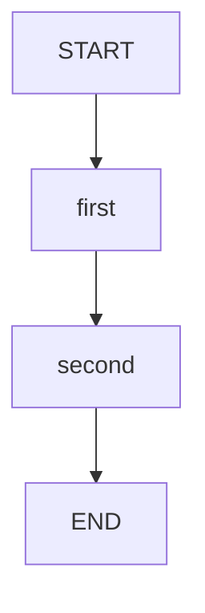

# 03 · 状态与 Reducer：同样的更新，不同的合并

节点返回的 Map 不是最终答案，而是一组待合并的更新。
本课让两个节点写相同的键，直接观察累加、去重追加、保留重复和替换的区别。
这是理解循环、并行、消息历史和幂等记录的共同基础。

源码入口：[ReducerGraphDemo](#课程实现)与[LearningState](#共享合并规则)。

## 学习目标

- 从 `LearningState.SCHEMA` 判断某个字段的更新规则。
- 分清“返回增量”和“返回新的总量”。
- 证明 `appender` 与 `appenderWithDuplicate` 在本版本并不等价。
- 给状态字段选择符合业务含义的合并策略。

## 原生拓扑



两节点顺序执行，没有竞争条件。
因此这里的结果差异完全由 Channel 决定，而不是并发先后顺序导致。
原生 Mermaid 可通过以下接口查看，站点代码围栏不依赖渲染插件：

```bash
curl -sS http://127.0.0.1:8099/api/demos/demo03/graph
```

## 状态合并演算表

| 字段 | 输入或初值 | `first` 更新 | `second` 更新 | 最终值 |
|---|---|---|---|---|
| `first` | 输入 `2` | 不改 | 不改 | `2` |
| `second` | 输入 `3` | 不改 | 不改 | `3` |
| `sum` | 默认 `0` | `2` | `3` | `5` |
| `events` | 默认空列表 | `["same"]` | `["same"]` | `["same"]` |
| `trace` | 默认空列表 | `["same"]` | `["same"]` | `["same","same"]` |
| `replacement` | 未设置 | `"first"` | `"second"` | `"second"` |

`first` 同时是节点 ID 和输入字段名，但二者属于不同命名空间。
不要因为名称相同，就认为图引擎自动把输入分配给同名节点。
节点明确通过 `s.integer("first", 0, 100)` 读取它。

## 真正决定结果的是 schema

```java
"sum", Channels.base(Integer::sum, () -> 0),
"events", Channels.appender(ArrayList::new),
"trace", Channels.appenderWithDuplicate(ArrayList::new)
```

以上摘自 `LearningState`；`replacement` 没有声明 Channel，因此后值覆盖前值。
本课采用 LangGraph4j 1.9.0：`appender` 对相等元素去重。
要记录“同一动作发生了两次”，应使用 `appenderWithDuplicate`，不能只凭名字推断。

算式是 `0 + 2 + 3 = 5`。
第二节点返回的是 `3`，而不是自己读取旧和后返回 `5`。
如果错误地返回累计值 `5`，Reducer 会继续做 `2 + 5`，结果成为 `7`。

追加器也应只收到本次新增项。
返回完整历史不仅浪费复制；在保留重复的追加器下还会反复复制旧事件。
去重追加器有时会掩盖这个错误，因此不能依赖去重来修补更新协议。

## 默认请求与结果

```bash
curl -sS -X POST http://127.0.0.1:8099/api/demos/demo03/run \
  -H 'Content-Type: application/json' \
  -d '{"input":{"first":2,"second":3}}'
```

省略任一输入字段时，HTTP 层会补入该课的样例默认值。
只提交业务输入；不要尝试从请求注入 `sum`、`trace` 等内部状态。
确定性结果子集：

```json
{
  "demoId": "demo03",
  "status": "COMPLETED",
  "state": {
    "sum": 5,
    "events": ["same"],
    "trace": ["same", "same"],
    "replacement": "second"
  }
}
```

`visitedNodes` 中的业务顺序为 `first → second`。
`trace` 的内容则是节点主动写的 `same`，不是执行层自动生成的节点名称。
两者可以用来回答不同问题：路径说明去哪了，业务轨迹说明记录了什么。

## 实验：零增量是不是没执行？

改成 `{"input":{"first":0,"second":0}}`。
预期 `sum` 为 `0`，但 `events` 仍有一个 `same`，`trace` 仍有两个。
`replacement` 仍然是 `second`，两个节点都执行过。
所以“数值没变”不能作为“节点没执行”的证据。

再改成 `first=100, second=100`，最终和为 `200`。
输入的每项限制为 0 到 100，不代表累加结果也限制在 100 内。
若把 `first` 设为 `-1`、`101`、字符串 `"2"` 或小数，都不是合法输入。

## 深入问题：什么需要去重？

- 来源集合：同一条来源出现两次，通常只需要展示一次，适合 `facts` 式去重。
- 操作轨迹：相同操作被尝试两次，两次都应可见，适合 `trace`。
- 模型消息：重复内容可能代表不同轮对话，本项目 `messages` 保留重复。
- 当前业务状态：如 `pending` 到 `approved`，通常需要替换而不是列表追加。

本例的字符串相等容易判断；复杂对象的去重还依赖对象相等语义。
不要把“去重追加”当作数据库唯一约束，也不要据此声称外部副作用只发生一次。

## 课程源码

[课程实现](#课程实现)与[共享合并规则](#共享合并规则)应一起阅读。
测试 `reducersShowSumAppendDedupDuplicatesAndReplacement` 分别断言四种结果。

### 课程实现

<<< ../../src/main/java/com/xb/langgraph/demo03/ReducerGraphDemo.java

### 共享合并规则

<<< ../../src/main/java/com/xb/langgraph/LearningState.java

继续阅读[条件路由](./04-routing)，或对照[幂等课](./14-idempotency)观察去重记录的边界。
