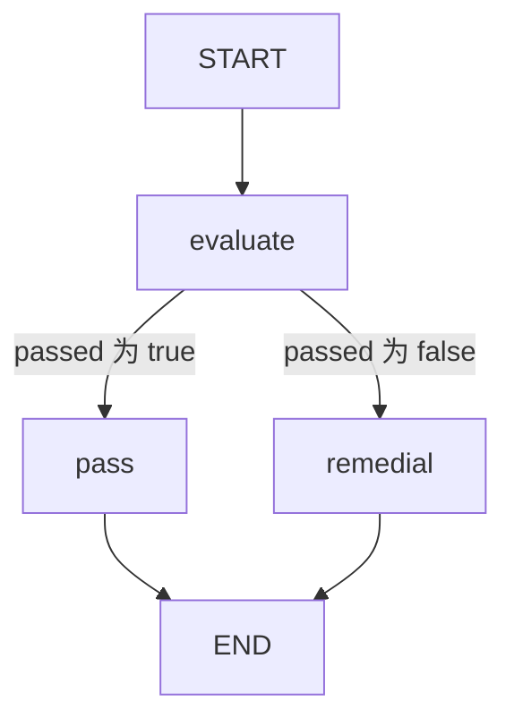

# 04 · 条件路由：只执行被选中的分支

本课以成绩是否达到 60 分为条件，选择通过或补学路径。
重点不是 `if` 本身，而是把计算判断的节点与选择后继的条件边分开。

源码入口：[ConditionalGraphDemo 与完整实现](#课程源码)。

## 学习目标

- 先由节点产生路由依据，再由条件边读取它。
- 理解逻辑标签到目标节点的映射。
- 通过真实访问路径证明未选分支没有执行。
- 区分合法业务结果与输入校验失败。

## 原生拓扑



每次请求只走 `pass`、`remedial` 之一，不会先运行两者再挑结果。
分支共享结束标记，但这里没有并行汇合。
Mermaid 代码可直接阅读；核对原生导出：

```bash
curl -sS http://127.0.0.1:8099/api/demos/demo04/graph
```

## 状态契约

| 字段 | 输入/默认 | 更新者 | 最终解释 |
|---|---|---|---|
| `score` | 整数 `85` | 不更新 | 原始成绩，范围 0..100 |
| `passed` | 无 | `evaluate` | `score >= 60` 的布尔结果 |
| `status` | 无 | `pass` 或 `remedial` | `pass` 或 `remedial` |

`passed` 与 `status` 都是替换型字段，不需要 Reducer 累加。
`score` 不合法时，不能为了完成图而默认选择补学；应停止并报告输入问题。
补学是合法成绩产生的业务路径，不是异常处理器。

## 源码中的三层职责

第一层是输入校验和业务判断：

```java
.addNode("evaluate", node_async(s ->
    Map.of("passed", s.integer("score", 0, 100) >= 60)))
```

第二层是控制流：

```java
.addConditionalEdges("evaluate",
    edge_async(s -> s.decision("passed") ? "pass" : "remedial"),
    Map.of("pass", "pass", "remedial", "remedial"))
```

第三层是被选节点写入业务状态。
本例标签和节点 ID 恰好相同，但它们仍有不同角色。
例如标签可以叫 `qualified`，再映射到节点 `pass`；标签必须能在映射表中找到。

条件边只读状态，没有扣费、写数据库或修改状态等副作用。
这样即使重新读取路由依据，也不会多做一次业务动作。
`s.decision()` 要求真正的 Boolean，不能把 `"true"` 字符串当布尔值。

## 默认运行

```bash
curl -sS -X POST http://127.0.0.1:8099/api/demos/demo04/run \
  -H 'Content-Type: application/json' \
  -d '{"input":{"score":85}}'
```

默认输入来自 `sampleInput()`；提交 `{"input":{}}` 也会使用 85。
响应确定性子集：

```json
{
  "demoId": "demo04",
  "status": "COMPLETED",
  "state": {"score": 85, "passed": true, "status": "pass"}
}
```

顶层 `status` 是执行层的 `COMPLETED`；`state.status` 是课程定义的 `pass`。
业务节点访问顺序应为 `evaluate → pass`，不应出现 `remedial`。

## 实验：用两个边界值证实条件

```bash
curl -sS -X POST http://127.0.0.1:8099/api/demos/demo04/run \
  -H 'Content-Type: application/json' -d '{"input":{"score":59}}'
curl -sS -X POST http://127.0.0.1:8099/api/demos/demo04/run \
  -H 'Content-Type: application/json' -d '{"input":{"score":60}}'
```

预期答案：

| 成绩 | `passed` | `state.status` | 业务路径 |
|---|---|---|---|
| 59 | false | remedial | evaluate → remedial |
| 60 | true | pass | evaluate → pass |

两次顶层状态都应为 `COMPLETED`，因为补学不是图执行失败。
`CurriculumTest.conditionalAndLoopBoundaries` 正是用这组边界检查路由。
不要只测试默认的 85，否则无法区分源码写的是 `>= 60` 还是 `> 60`。

## 非法输入与排错

尝试 `score=101`、`score=-1`、`score="60"` 或 `score=60.5`。
这些输入不满足整数范围约束，不能期待得到正常分支结果。
错误可能在 HTTP 校验阶段返回，也可能由节点校验暴露；不要固定猜测错误 JSON。
判断时首先看是否成功创建执行，再看执行状态及错误信息。

如果路径错误但 `passed` 正确，优先检查条件映射。
如果 `passed` 已错误，则检查 `evaluate` 的表达式和输入。
如果输出字段正确但两个分支都出现，应检查是否误用了两条普通边而不是条件边。

## 陷阱与边界

- 条件边不会自动校验所有业务字段；校验仍由节点或应用边界负责。
- `state.status` 名称不是引擎保留的“只能用固定枚举”的业务约束。
- 本课不包含人工审核；不能给它调用 resume 来改一次成绩的结果。
- 改成绩应新建执行，而不是任意注入历史状态键。
- 原生 API 属于 `org.bsc.langgraph4j`，不是 Alibaba Graph 的 `OverAllState`。

## 课程源码

源码路径：`src/main/java/com/xb/langgraph/demo04/ConditionalGraphDemo.java`。

<<< ../../src/main/java/com/xb/langgraph/demo04/ConditionalGraphDemo.java

继续阅读[循环与退出](./05-loop)：把条件边指回已执行节点，就需要证明一定能退出。
