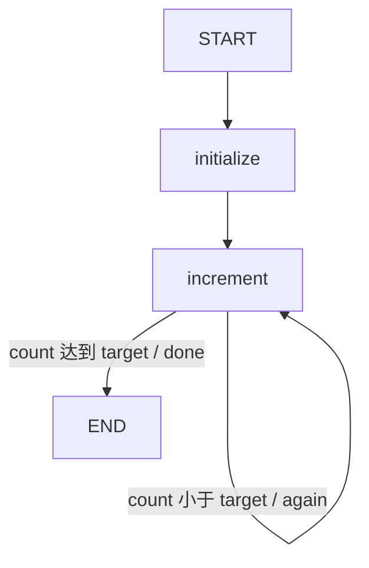

# 05 · 循环与退出：让回边有终点

图可以重新访问同一个节点，但必须有明确的进度指标与退出条件。
本课从 0 开始计数，到达指定目标后结束；目标最大为 10，便于手算和检查。

源码入口：[LoopGraphDemo 与完整实现](#课程源码)。

## 学习目标

- 用条件边实现回边，而不是在节点里隐藏整个 while 循环。
- 解释当前计数为何采用替换而非累加 Reducer。
- 根据输入推导节点被访问的次数。
- 区分业务上的终止证明和引擎的安全限制。

## 原生拓扑



`initialize` 只进入一次；`increment` 可以被重复访问。
比较发生在 `increment` 返回更新并合并之后，所以第一次比较时计数已经是 1。
Mermaid 围栏是教学说明，原生图文本可查询：

```bash
curl -sS http://127.0.0.1:8099/api/demos/demo05/graph
```

## 状态契约与默认过程

| 字段 | 输入或初始化 | 更新 | 输出 |
|---|---|---|---|
| `target` | 输入整数，默认 `3`，范围 1..10 | 不更新 | 仍为 3 |
| `count` | `initialize` 写 `0` | 每次 `increment` 写旧值 + 1 | 最终 3 |

`count` 没有在共享 schema 里声明累加规则。
因此节点返回 `旧 count + 1` 是新总量，不是“追加一个增量”。
不要把它和第 03 课的 `sum` 混为一谈。

默认执行可逐步列出：

| 步骤 | 执行节点 | 更新后 count | 下一步 |
|---|---|---|---|
| 1 | initialize | 0 | increment |
| 2 | increment | 1 | increment |
| 3 | increment | 2 | increment |
| 4 | increment | 3 | END |

## 源码的终止条件

```java
.addNode("initialize", node_async(s -> {
    s.integer("target", 1, 10);
    return Map.of("count", 0);
}))
.addNode("increment", node_async(s ->
    Map.of("count", s.count("count") + 1)))
```

`initialize` 既验证目标，也重置这次执行的计数。
后续路由把 `again` 映射回 `increment`，把 `done` 映射到 `END`。
节点承担进度推进，边承担是否继续；两者职责分开。

为什么能结束？
`target` 有限且固定，`count` 从 0 开始，每次严格增加 1。
每轮都会缩小 `target - count`，最多执行 `target` 次增量节点。
这比“应该不会死循环”的直觉更可靠。

## 请求与预期结果

```bash
curl -sS -X POST http://127.0.0.1:8099/api/demos/demo05/run \
  -H 'Content-Type: application/json' \
  -d '{"input":{"target":3}}'
```

HTTP `run` 合并样例输入；省略 `target` 使用 3，不会沿用上一次执行的目标。
确定性响应子集：

```json
{
  "demoId": "demo05",
  "status": "COMPLETED",
  "state": {"target": 3, "count": 3}
}
```

业务访问序列为 `initialize → increment → increment → increment`。
不要把重复节点名当作日志重复错误；它们代表真实的多次访问。
本课没有向 `trace` 写入节点名，观察路径使用执行响应的 `visitedNodes`。

## 实验：最小值与最大值

分别发送 `{"input":{"target":1}}` 和 `{"input":{"target":10}}`。
预期答案是计数分别为 1、10，增量节点分别出现 1、10 次。
初始化节点都只出现一次。

再尝试目标为 0。
它不会运行零次后成功结束，而是在 `initialize` 校验时失败，因为本课只接受 1..10。
若要支持零目标，不能只放宽校验：还必须在进入 `increment` 前增加分流。
否则当前拓扑一定先加一次，与“目标为零不计数”的需求冲突。

## 反事实练习

假设把 `count` 也配置成 `Integer::sum`，但节点仍返回 `旧值 + 1`。
前三次更新会得到 1、3、7，而不是 1、2、3。
因此 Reducer 改动必须和节点更新协议一起审查，不能只看字段类型相同。

假设把回边连到 `initialize`，会怎样？
答案：每轮都重置为 0，目标大于 1 时无法取得进展。
引擎安全限制可能终止错误执行，但这不是正常业务退出策略。

## 陷阱与边界

- 循环次数不能由未经约束的外部输入无限增大。
- 不要依赖节点注册顺序来实现循环，必须显式连接回边。
- 新执行用 `GraphInput.args`；循环是同一次执行内部调度，不是客户端重复调用 resume。
- 错误执行与正常达到目标不同；不要把异常中断后的 count 当最终完成值。
- 若循环体有外部副作用，需要重试与幂等设计，本课只更新内存状态。

## 课程源码

源码路径：[LoopGraphDemo.java](../../src/main/java/com/xb/langgraph/demo05/LoopGraphDemo.java)。

<<< ../../src/main/java/com/xb/langgraph/demo05/LoopGraphDemo.java

测试依据：`conditionalAndLoopBoundaries` 检查目标 10 与非法目标 0。
下一课转向不同节点同时工作：[并行与汇合](./06-parallel)。
