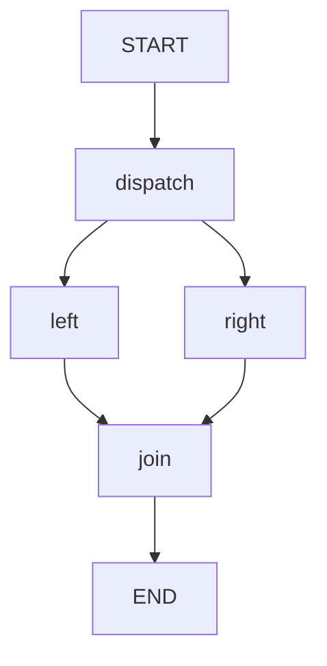

# 06 · 并行与汇合：拓扑扇出不等于自动并发

本课让左右两个资料分支汇入一个节点，再产生稳定排序的摘要。
除了看图有两条边，还要确认执行器已绑定，并用测试证明两个动作真实重叠。

源码入口：[ParallelFanoutDemo](#课程实现)与[并发屏障测试](#并发验证)。

## 学习目标

- 建立单步并行分支和共同汇合节点。
- 通过 RunnableConfig 显式绑定并行执行器。
- 理解共享 `facts` 的合并与最终展示排序是两件事。
- 用同步屏障验证并发，而不是猜测毫秒耗时。

## 原生拓扑



`dispatch` 校验主题，随后左右分支读取同一主题、分别贡献事实。
`join` 应在两侧贡献合并之后读取 `facts`。
两个分支的完成先后不作保证；不要把图的左右位置理解为顺序。

```bash
curl -sS http://127.0.0.1:8099/api/demos/demo06/graph
```

这里返回原生 Mermaid 文本；本页代码围栏无需 Mermaid 插件。

## 状态输入、更新和输出

| 字段 | 输入/初值 | 更新者与增量 | 默认输出 |
|---|---|---|---|
| `topic` | `LangGraph4j` | 分支只读 | `LangGraph4j` |
| `facts` | 去重追加空列表 | left、right 各返回一个字符串 | 含两个事实，顺序不作契约 |
| `joined` | 无 | join 排序后连接 | `left:LangGraph4j \| right:LangGraph4j` |

`facts` 使用 `Channels.appender`，会去除相等元素。
分支应返回各自新增的一项，而不是读出整个列表后重新写回。
共享键有明确 Reducer，才能解释两个更新如何成为同一份结果。

## 执行器是关键配置

```java
public RunnableConfig config(String threadId) {
    return RunnableConfig.builder().threadId(threadId)
        .addParallelNodeExecutor("dispatch", ForkJoinPool.commonPool())
        .build();
}
```

绑定名是扇出源节点 `dispatch`，不是 `left`、`right`，也不是 `join`。
`node_async` 只适配同步动作，本身不保证同步函数在多个线程上同时运行。
直接运行课程时应使用 `demo.config(id)`，不要随手构造一个丢失执行器的配置。

默认构造器为两侧提供本地函数：`left:` 和 `right:` 加主题。
另一个构造器接收两个 `Function<String,String>`，用于替换数据来源，而不是替换调度器。
这让测试能在动作内部加屏障，仍然验证真实的原生图调度。

## 发起默认请求

```bash
curl -sS -X POST http://127.0.0.1:8099/api/demos/demo06/run \
  -H 'Content-Type: application/json' \
  -d '{"input":{"topic":"LangGraph4j"}}'
```

省略 `topic` 时使用样例默认值。响应的稳定子集：

```json
{
  "demoId": "demo06",
  "status": "COMPLETED",
  "state": {"joined": "left:LangGraph4j | right:LangGraph4j"}
}
```

另外检查 `facts` 同时包含 `left:LangGraph4j` 和 `right:LangGraph4j`。
不要精确断言它们的数组顺序。
`joined` 稳定，是因为汇合节点显式执行 `stream().sorted()`，不是并发顺序稳定。
原生并行输出可能以组合节点形式暴露；不要仅凭 `visitedNodes` 的展开形式证明动作重叠。

## 实验一：改主题并预测汇合

提交 `{"input":{"topic":"并行"}}`。
预期两个事实是 `left:并行`、`right:并行`，摘要是 `left:并行 | right:并行`。
换主题不会改变拓扑，也不会创建新的动态分支。

## 实验二：怎样证明不是串行？

阅读下方的 `ParallelExecutionTest`。
两个动作先把同一个 `CountDownLatch(2)` 各减一次，再等待两者都进入。
若串行执行，第一个动作无法等到第二个动作进入，会触发超时保护。
测试不是要求“少于某毫秒”，而是要求“任何一个完成前，两者都已进入”。

预期答案：屏障计数归零，两个事实到达汇合状态。
10 秒只防止错误实现永久挂起，不是性能达标值。
此页引用的是测试逻辑；是否通过应以当前项目实际运行测试结果为准。

## 原生并行限制与工程边界

- topic 必须是 1..2000 字符的非空字符串；dispatch 先校验，非法输入不应进入正常分支汇合。
- LangGraph4j 1.9.5 直接并行分支限制为单步，并应汇合到共同节点。
- 复杂多步分支可以封装为编译子图，不能随意画任意深度并行 DAG 后假定支持。
- `ForkJoinPool.commonPool()` 是教学配置；阻塞 I/O、隔离需求和容量需要单独评估。
- 并行不自动提供事务、失败补偿、取消传播或外部调用的 exactly-once。
- 不要用 sleep 人为制造“看起来并行”的效果；先验证动作重叠，再测真实负载性能。
- 若两侧返回完全相同事实，去重后只剩一项；两项数量断言依赖样例来源内容不同。

## 课程源码

[实现](#课程实现)与[并发验证](#并发验证)配合阅读。

### 课程实现

<<< ../../src/main/java/com/xb/langgraph/demo06/ParallelFanoutDemo.java

### 并发验证

<<< ../../src/test/java/com/xb/langgraph/ParallelExecutionTest.java

概念边界见[框架对照](/guide/comparison)；下一课学习[子图组合](./07-subgraph)。
