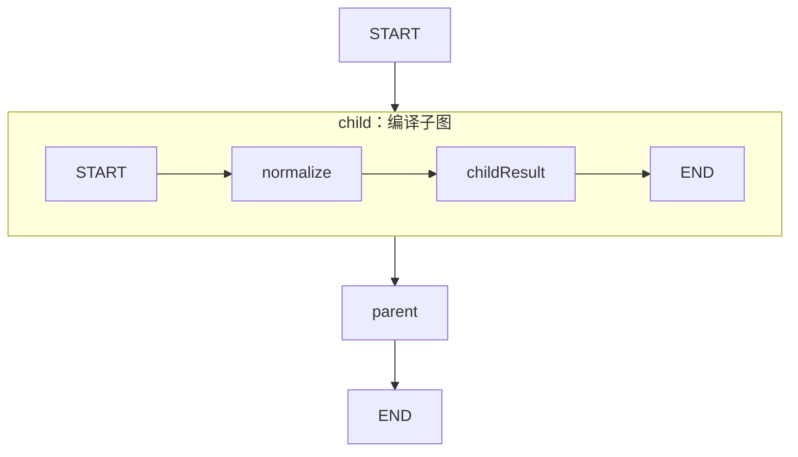

# 07 · 子图组合：把可执行图放进父图

当一段流程已经有自己的节点与边，可以先编译，再作为父图的一个节点复用。
本课的子图负责规范化主题，父图负责把子图结果整理成最终输出。
不是在父节点内部手写调用循环，而是使用原生编译子图注册方式。

源码入口：[SubgraphDemo 与完整实现](#课程源码)。

## 学习目标

- 分辨子图定义、子图编译结果和父图中的子图节点。
- 识别父子图之间实际使用的状态键。
- 理解共享状态便利性与命名耦合的代价。
- 不把子图组合误认为远程服务调用或自动隔离。

## 原生拓扑



父图观察到 `child → parent`；子图内部执行 `normalize → childResult`。
图中的子图起止与父图起止属于不同层次，不能连成同一个业务节点。
此处是展开后的教学示意，原生导出的嵌套展示形式以接口为准：

```bash
curl -sS http://127.0.0.1:8099/api/demos/demo07/graph
```

代码围栏不要求站点安装 Mermaid 插件。

## 状态输入与输出边界

| 字段 | 初始来源 | 写入位置 | 默认结果 |
|---|---|---|---|
| `topic` | 输入 `LangGraph4j` | 父子图读取 | `LangGraph4j` |
| `normalized` | 无 | 子图 normalize | `LANGGRAPH4J` |
| `childOutput` | 无 | 子图 childResult | `LANGGRAPH4J` |
| `result` | 无 | 父图 parent | `父图收到：LANGGRAPH4J` |

父子图都使用 `LearningState.SCHEMA` 和 `LearningState::new`。
本课依靠这些共享键传递数据，没有另设 DTO 或输入输出映射器。
`childOutput` 是明确的交接字段；父图不需要重新做大写转换。

## 源码阅读顺序

先看局部变量 `child`：它先建图，连接两个节点，然后立即 `.compile()`。
`normalize` 调用 `toUpperCase(Locale.ROOT)`，避免依赖机器的默认语言区域。
`childResult` 把规范化文本写到约定的输出键。

再看父图的注册：

```java
.addNode("child", child)
.addNode("parent", node_async(s ->
    Map.of("result", "父图收到：" + s.text("childOutput"))))
```

这里第二个参数是真正的编译图，不是一个字符串名字，也不是手动调度的函数。
父图通过普通边等待子图结束，再进入 `parent`。

拆分的收益是把内部步骤封装成可组合单元。
但共享状态仍有耦合：若子图把 `childOutput` 改名，父节点必须同步修改。
因此复用前应明确读哪些键、写哪些键，不能只给子图起个好听的名字。

## 默认执行

```bash
curl -sS -X POST http://127.0.0.1:8099/api/demos/demo07/run \
  -H 'Content-Type: application/json' \
  -d '{"input":{"topic":"LangGraph4j"}}'
```

`run` 合并样例默认值；空输入对象仍使用 `LangGraph4j`。
确定性结果子集：

```json
{
  "demoId": "demo07",
  "status": "COMPLETED",
  "state": {
    "normalized": "LANGGRAPH4J",
    "childOutput": "LANGGRAPH4J",
    "result": "父图收到：LANGGRAPH4J"
  }
}
```

父图必须在子图输出可用后才生成 `result`。
子图内部事件是否展开到 HTTP 的 `visitedNodes`，取决于运行时输出适配方式；
不要把“列表里没有每个内部节点”直接等同于“子图没执行”。
先检查状态依赖和原生图，再检查事件暴露层。

## 实验：清理空白与区域无关转换

提交 `{"input":{"topic":"  java 21  "}}`。
预期 `normalized` 与 `childOutput` 均为 `JAVA 21`，最终为 `父图收到：JAVA 21`。
`inputText()` 清理外部主题首尾空白，但中间空格保留；大写转换不改变数字。

思考：为什么不直接在父图里读取 `normalized`？
答案：本例确实可以，但通过 `childOutput` 可以表达稳定交接协议。
若内部规范化步骤以后拆成更多字段，父图仍只依赖一个输出字段。

## 边界实验

空白主题、非字符串、超过 2000 字符的主题会触发 `inputText()` 校验。
内部 `text()` 只检查字符串类型，不限制生成内容的长度，也不清理它的空白。
输入 2000 个 `ß`，规范化后得到 2000 组 `SS`，仍能传给父图并正常生成结果。
`uppercaseExpansionIsNotLimitedAsExternalInput` 测试覆盖此场景，避免把生成内容错当外部输入。

## 陷阱与设计边界

- 子图不是自动的安全沙箱，也不是独立数据库事务。
- 本课没有演示子图内部人工审核；不能从简单组合推断所有中断场景。
- 父子使用同名累加字段时，要核实跨边界更新语义，避免重复累计。
- 本例只传替换型文本字段，刻意避开复杂消息合并问题。
- 在原生单步并行分支限制下，编译子图可作为封装多步骤分支的手段；仍需验证汇合与状态。
- 新图执行使用 `GraphInput.args`，不是传入 `null` 表示新执行或恢复。

## 课程源码

源码路径：`src/main/java/com/xb/langgraph/demo07/SubgraphDemo.java`。

<<< ../../src/main/java/com/xb/langgraph/demo07/SubgraphDemo.java

`CurriculumTest.sampleOutputs` 验证父图结果为 `父图收到：LANGGRAPH4J`。
继续阅读[检查点与历史](./08-checkpoint)，观察图结束后还可以保留哪些执行信息。
