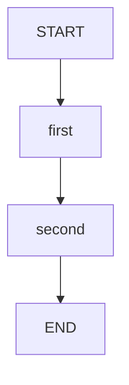

# 08 · 检查点与历史：最终值之外，还能看到什么

同一个字段被后继节点覆盖后，最终状态不会保留旧值。
检查点让我们回看某一步的状态与下一步位置；它和在业务状态里追加日志不是同一种机制。
本课用两次覆盖 `result`，说明最终状态、最新检查点和历史快照的区别。

源码入口：[CheckpointDemo 与完整实现](#课程源码)。

## 学习目标

- 为编译图配置原生 saver，并保留完成后的线程检查点。
- 用 threadId 查询最新状态，用历史 config 查询指定旧状态。
- 分清读取历史、恢复执行与回滚外部业务。
- 明确 `MemorySaver` 只能提供进程内保存。

## 原生拓扑



业务图只有两个节点，没有专门的“保存检查点”节点。
检查点由编译配置与执行机制负责，而不是插入一个伪业务步骤。
原生拓扑文本：

```bash
curl -sS http://127.0.0.1:8099/api/demos/demo08/graph
```

Mermaid 围栏可以直接作为文本阅读。

## 状态变化

| 字段 | 输入/默认值 | first 后 | second 后 |
|---|---|---|---|
| `label` | `checkpoint` | 保留 | 保留 |
| `result` | 无 | `checkpoint:one` | `checkpoint:done` |

`result` 是替换型字段，所以最终值不包含 `:one`。
如果只看最后响应，无法知道这个字段此前被写过什么。
检查点历史则可以找到 `result=checkpoint:one` 的快照。

## 编译配置在哪里起作用

课程的 `graph()` 仅定义业务图；测试和运行层在编译时装配 saver：

```java
var app = demo.graph().compile(CompileConfig.builder()
    .checkpointSaver(new MemorySaver())
    .releaseThread(false)
    .build());
var config = demo.config("checkpoint-local");
app.invoke(GraphInput.args(demo.sampleInput()), config);
var history = app.getStateHistory(config);
```

`releaseThread(false)` 对教学很重要：完成后仍保留活跃检查点供查询。
当前课程采用 `MemorySaver`，数据存在 JVM 进程内，不是文件、数据库或持久卷。
重启服务后，旧执行记录不能被当作可持久恢复的依据。
HTTP 运行层最多保留 100 个执行，容量满时优先淘汰已结束执行；即使未重启，旧 ID 也可能失效。

下面的原生逻辑对应测试中的历史读取：

```java
var old = history.stream()
    .filter(snapshot -> "checkpoint:one".equals(
        snapshot.state().value("result").orElse(null)))
    .findFirst().orElseThrow();
var oldState = app.getState(old.config()).state();
var latestState = app.getState(config).state();
```

`old.config()` 带有定位历史检查点的信息；原始 threadId 配置则用于查询最新位置。
原生 `getStateHistory` 按新到旧返回，不要把第一项当作最早一步。
HTTP `/history` 则由运行层反转为旧到新，便于按时间阅读；两者顺序不可混用。
上面的 `checkpoint-local` 只是直接调用示例的线程标签，不是 HTTP executionId。

## 运行与读取历史

```bash
curl -sS -X POST http://127.0.0.1:8099/api/demos/demo08/run \
  -H 'Content-Type: application/json' \
  -d '{"input":{"label":"checkpoint"}}'
```

默认值可以由空输入对象补齐。完成响应的稳定子集：

```json
{
  "demoId": "demo08",
  "status": "COMPLETED",
  "state": {"label": "checkpoint", "result": "checkpoint:done"}
}
```

把实际返回的 ID 填入变量，再查看同一次执行：

```bash
EXECUTION_ID='替换为响应中的 executionId'
curl -sS "http://127.0.0.1:8099/api/executions/$EXECUTION_ID"
curl -sS "http://127.0.0.1:8099/api/executions/$EXECUTION_ID/history"
```

历史中应能找到 `checkpoint:one`，最新状态为 `checkpoint:done`。
测试要求历史至少有 3 个快照，不把内部起止快照数量固定成一份不可变协议。
`visitedNodes` 的业务顺序是 `first → second`。

## 实验：证明查询旧状态不会改变最新状态

将 label 改成 `audit`，重新创建执行并记录新的 ID。
预期最终值为 `audit:done`，历史中存在 `audit:one`。
读取旧历史后再次查询当前执行，当前值仍应是 `audit:done`。

原因：查询快照是只读观察，不会把图当前位置移动回旧节点。
测试 `checkpointsExposeHistoryAndHistoricalConfiguration` 在原生层验证了这一区别。
“时间旅行”在这里首先指定位旧状态，不意味着所有外部系统一起回到过去。

## 陷阱与边界

- label 通过 inputText() 校验：非空字符串、最多 2000 字符，使用时清理首尾空白。
- 不能只创建 `MemorySaver` 却没有把它传给 `CompileConfig`。
- 不能每次查询都新建一个空 saver，再期待读到旧执行。
- threadId 不是权限令牌；知道 ID 不代表在生产系统中应获得访问权。
- 历史快照不是业务审计制度的完整替代：持久化、权限、保留期和脱敏需要单独设计。
- 本课 HTTP 只演示运行和查询，不提供任意历史回滚、分支重放接口。
- 重放有副作用的节点可能重复发消息或付款，检查点不自动消除这一风险。
- 不要用 `GraphInput.noArgs()` 假装恢复；恢复语义应明确用 `GraphInput.resume()`。

## 课程源码

源码路径：[CheckpointDemo.java](../../src/main/java/com/xb/langgraph/demo08/CheckpointDemo.java)。

<<< ../../src/main/java/com/xb/langgraph/demo08/CheckpointDemo.java

测试依据：`CurriculumTest.checkpointsExposeHistoryAndHistoricalConfiguration`。
继续阅读[线程隔离](./09-isolation)，理解同一 saver 如何区分不同执行。
