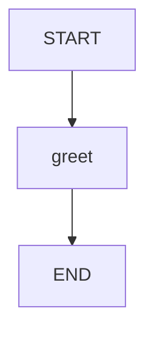

# 09 · 线程隔离：共享图，不共享会话状态

本课的业务逻辑仍然只有问候，但研究对象变成执行配置。
同一个编译图和同一个 saver，使用不同 threadId 后，应能分别读取甲与乙的状态。
这里的 thread 是工作流会话命名空间，不是操作系统线程。

源码入口：[ThreadIsolationDemo 与完整实现](#课程源码)。

## 学习目标

- 区分 Java 线程、原生 threadId 与 HTTP executionId。
- 在共享编译图上为不同执行设置独立标识。
- 用同一 saver 的查询结果证明状态没有串线。
- 认识状态隔离和身份授权不是同一问题。

## 原生拓扑



两次请求用的是相同拓扑，不是为甲、乙各写一份图定义。
隔离发生在执行状态存储与配置层，不发生在图节点名称上。
查看原生 Mermaid：

```bash
curl -sS http://127.0.0.1:8099/api/demos/demo09/graph
```

本页图作为文本即可阅读，无需额外 Mermaid 插件。

## 状态与标识对照

| 项目 | 默认输入/来源 | 更新方式 | 作用 |
|---|---|---|---|
| `name` | 输入 `甲` | 节点只读 | 本次问候对象 |
| `greeting` | 无 | greet 替换写入 | `你好，甲！` |
| 原生 `threadId` | RunnableConfig | 不由业务节点写入 | saver 会话定位 |
| HTTP `executionId` | 服务响应 | 客户端只引用返回值 | 查询应用层执行 |

不要在 `input` 里塞入 `threadId` 来控制会话。
本课 HTTP 输入只有业务字段 `name`；运行层负责分配和保存执行标识。
原生配置不等于共享状态中的一个普通业务键。

## 原生隔离测试的关键

只有复用同一个编译图、同一个 saver，测试才真正覆盖共享存储下的隔离。
每个请求新建一张图和一份 saver，也许结果不同，但没有证明共享组件不会串线。
当前 HTTP 运行层恰好采用每 execution 独立编译图与 saver，属于更外层的隔离。
本课的原生 `CurriculumTest` 则刻意共享它们，验证 threadId 本身的命名空间语义：

```java
var demo = new ThreadIsolationDemo();
var app = demo.graph().compile(CompileConfig.builder()
    .checkpointSaver(new MemorySaver()).releaseThread(false).build());
app.invoke(GraphInput.args(Map.of("name", "甲")), demo.config("a"));
app.invoke(GraphInput.args(Map.of("name", "乙")), demo.config("b"));
var stateA = app.getState(demo.config("a")).state();
var stateB = app.getState(demo.config("b")).state();
```

`a`、`b` 是此段独立 Java 示例的标签，绝不是声称已存在的 HTTP executionId。
预期 A 的 greeting 为 `你好，甲！`，B 的 greeting 为 `你好，乙！`。
后运行 B 不应覆盖 A 的最新检查点。

## HTTP 实验：连续创建两次执行

```bash
curl -sS -X POST http://127.0.0.1:8099/api/demos/demo09/run \
  -H 'Content-Type: application/json' -d '{"input":{"name":"甲"}}'
curl -sS -X POST http://127.0.0.1:8099/api/demos/demo09/run \
  -H 'Content-Type: application/json' -d '{"input":{"name":"乙"}}'
```

第一份响应的确定性子集：

```json
{
  "demoId": "demo09",
  "status": "COMPLETED",
  "state": {"name": "甲", "greeting": "你好，甲！"}
}
```

第二份应为 `name=乙`、`greeting=你好，乙！`，且两份真实 executionId 不同。
默认 `sampleInput()` 是甲；`{"input":{}}` 会使用甲，不会沿用乙。
每次 `visitedNodes` 的业务部分都只包含 `greet`。

分别替换两次响应中的 ID：

```bash
EXECUTION_A='替换为甲的 executionId'
EXECUTION_B='替换为乙的 executionId'
curl -sS "http://127.0.0.1:8099/api/executions/$EXECUTION_A"
curl -sS "http://127.0.0.1:8099/api/executions/$EXECUTION_B"
curl -sS "http://127.0.0.1:8099/api/executions/$EXECUTION_A/history"
```

预期再次读取甲仍然得到甲的问候；甲的历史不应出现乙的业务输入。
不要在这一实验中把两个变量都填写成最后一次响应的 ID。

## 进阶实验与答案

如果原生 Java 实验把两次 config 都设为 `a`，会发生什么？
答案：两次调用不再属于两个隔离命名空间，不能期待还能分别按 `a` 找回两个“最新会话”。
具体续写或覆盖行为还受检查点位置及输入语义影响；不要用复用 ID 充当新建执行。

如果把执行移到另一台 JVM，原来的 threadId 是否足够？
答案：不够。当前 `MemorySaver` 是进程内存，另一进程没有原来的检查点。
需要明确的共享持久化方案，而不是只保持 ID 字符串一致。

## 边界与陷阱

- 不同 threadId 隔离状态，不保证同一 threadId 的并发写入安全。
- 生产恢复接口应防止同一审核被同时提交；会话键本身不是并发锁。
- 不要在单例节点字段里保存“当前用户结果”；本课节点只从传入状态读取。
- 输入 `name` 仍受非空字符串、最大 2000 字符约束。
- 知道执行 ID 不是身份验证；多租户服务仍需权限校验和数据归属检查。
- `MemorySaver` 不提供跨重启历史、备份或审计留存保证。

## 课程源码

源码路径：[ThreadIsolationDemo.java](../../src/main/java/com/xb/langgraph/demo09/ThreadIsolationDemo.java)。

<<< ../../src/main/java/com/xb/langgraph/demo09/ThreadIsolationDemo.java

测试依据：`threadsUseOneCompiledGraphAndOneSaverWithoutLeaking`。
接着阅读[人工介入](./10-human-review)，理解为什么恢复必须使用同一执行上下文。
