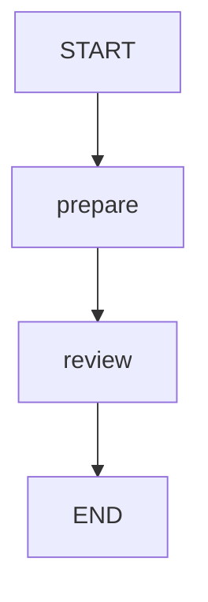

# 10 · 人工介入：先暂停，再执行审核节点

人工审核不是让 Java 线程一直等待输入，也不是重新跑一遍图。
本课在 `review` 执行前保存检查点，收到审核决定后再从当前位置继续。
通过与拒绝都是合法业务结局，都可以正常走到 END。

源码入口：[HumanReviewDemo 与完整实现](#课程源码)。

## 学习目标

- 识别 `interruptBefore` 的暂停时机。
- 用同一次 executionId 提交布尔决定，而不是任意注入状态。
- 理解更新状态与恢复图是两个原生动作。
- 区分 `WAITING_REVIEW`、`COMPLETED` 与业务 `rejected`。

## 原生拓扑与暂停位置



`review` 是真实节点；暂停点位于进入它之前，不是它执行完成之后。
初次运行已经完成 `prepare`，但还没有读取 `approved`。
图形里不额外添加一个不存在的等待节点；中断由编译配置表达。

```bash
curl -sS http://127.0.0.1:8099/api/demos/demo10/graph
```

接口返回原生 Mermaid 文本；本页围栏无需渲染插件。

## 状态契约

| 字段 | 来源 | 暂停时 | 恢复后 |
|---|---|---|---|
| `content` | 默认输入 `待审核文章` | 保留 | 保留 |
| `draft` | prepare 读取 content | `待审核文章` | 不变 |
| `status` | 节点更新 | `pending` | `approved` 或 `rejected` |
| `approved` | resume 决定映射 | 尚未提供 | true 或 false |

`approved` 必须是真正的 JSON 布尔值，不能发送 `"true"` 或 `1`。
`state.status` 是业务字段；响应顶层 `status` 是执行状态。
本课没有发布节点，即使审核同意，也只把状态设为 `approved`。

## 原生中断与恢复原理

`reviewNodes()` 返回 `Set.of("review")`，供运行层配置 `interruptBefore`。
原生测试的关键步骤如下：

```java
var config = demo.config(threadId);
app.invoke(GraphInput.args(demo.sampleInput()), config);
// 此时 app.getState(config).next() 为 review
app.updateState(config, Map.of("approved", true));
var result = app.invoke(GraphInput.resume(), demo.config(threadId));
```

编译时还需要 `checkpointSaver(new MemorySaver())` 和 `releaseThread(false)`。
恢复读取同一 threadId 的最新状态，继续执行尚未执行的审核节点。
也可以使用 `updateState` 返回的配置；不要把旧历史快照配置当成总是最新的位置。

不要把 `updateState(config, updates, "review")` 的第三参数当成“接下来执行 review”。
`asNode` 表示把更新当作该节点的输出，可能让执行越过审核节点。
本课要让 `review` 真正读取决定并写业务结果，因此不使用这种跳过方式。

## 第一步：发起执行

```bash
curl -sS -X POST http://127.0.0.1:8099/api/demos/demo10/run \
  -H 'Content-Type: application/json' \
  -d '{"input":{"content":"待审核文章"}}'
```

默认字段由 `sampleInput()` 提供，空输入对象会使用相同内容。
暂停响应的稳定子集：

```json
{
  "demoId": "demo10",
  "status": "WAITING_REVIEW",
  "pendingNode": "review",
  "state": {"draft": "待审核文章", "status": "pending"}
}
```

`visitedNodes` 此时应能观察到 `prepare`，不能声称 `review` 已完成。
保存这份响应真实生成的 executionId。

## 第二步：给当前审核一个决定

```bash
EXECUTION_ID='替换为刚才响应中的 executionId'
curl -sS -X POST "http://127.0.0.1:8099/api/executions/$EXECUTION_ID/resume" \
  -H 'Content-Type: application/json' -d '{"approved":true}'
curl -sS "http://127.0.0.1:8099/api/executions/$EXECUTION_ID"
```

注意 resume 请求没有外层 `input`，也不包含节点名或任意状态 Map。
运行层将这个决定映射给当前待处理审核，随后用 `GraphInput.resume()` 继续。
同意后的确定性子集：

```json
{
  "demoId": "demo10",
  "status": "COMPLETED",
  "state": {"draft": "待审核文章", "approved": true, "status": "approved"}
}
```

恢复过程不应重新执行 `prepare`；业务路径合起来是 `prepare → review`。
可用 `/api/executions/$EXECUTION_ID/history` 检查暂停前后的状态。

## 实验：拒绝是不是失败？

重新调用 run，取得一个新的 executionId，再用 `{"approved":false}` 恢复。
预期顶层为 `COMPLETED`，`state.status` 为 `rejected`。
原因是审核节点成功处理了否决意见，图正常结束；没有抛出执行异常。
不要在已经完成的第一次执行上反复 resume 来试图改票。

再试字符串决定 `{"approved":"false"}`。
预期不能被当作合法审核布尔值；不要依赖 JavaScript 的真值转换习惯。
直接向 run 输入添加 `approved` 也不是提前批准的授权入口。

## 陷阱与能力边界

- content 必须是 1..2000 字符的非空字符串，prepare 使用 inputText() 清理首尾空白后形成 draft。
- `GraphInput.args` 开始新输入，`GraphInput.resume` 恢复，`null` 不应作为含糊替代。
- `MemorySaver` 只在当前进程保存检查点；重启后不能保证继续之前的审核。
- 本例没有身份认证、审核角色控制、通知或 SLA 超时机制。
- 多次提交、并发审核、撤回决定需要应用层协议，不由布尔字段自动解决。
- `FAILED` 描述未能正常执行，不应拿来替代所有被拒绝的业务结果。

## 课程源码

源码路径：[HumanReviewDemo.java](../../src/main/java/com/xb/langgraph/demo10/HumanReviewDemo.java)。

<<< ../../src/main/java/com/xb/langgraph/demo10/HumanReviewDemo.java

测试 `humanReviewExecutesDecisionNodeOnResume` 分别验证同意与拒绝。
多级审核见[费用审批](./17-expense)；下一课先观察[节点流](./11-streaming)。
