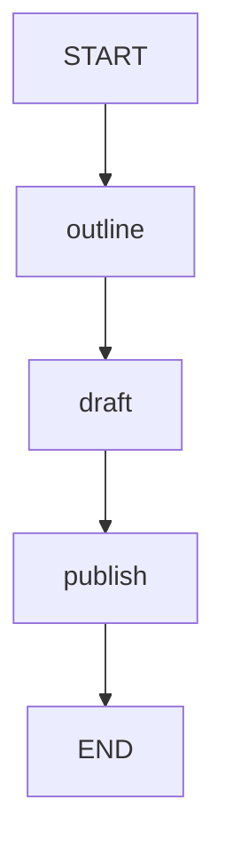

# 11 · 节点流与 SSE：看到步骤完成，而不是逐字生成

本课仍是提纲、正文、发布三步，变化在消费方式。
普通 run 聚合执行结果；stream 逐步消费原生节点输出，再通过 HTTP SSE 传给客户端。
这些事件不是语言模型的 Token，也不是模拟打字机动画。

源码入口：[NodeStreamingDemo 与完整实现](#课程源码)。

## 学习目标

- 区分图节点事件、模型 Token 和 HTTP SSE 传输。
- 认识 LangGraph4j 的 AsyncGenerator，而不是套用 Reactor Flux。
- 用 curl 的 `-N` 关闭客户端缓冲观察事件。
- 按节点顺序检查累积状态，不猜测固定 SSE 序列化外形。

## 原生拓扑



流式观察不会改变业务拓扑。
节点仍按依赖执行，只是消费者不必等到最后才开始读取引擎输出。
查看原生 Mermaid 文本：

```bash
curl -sS http://127.0.0.1:8099/api/demos/demo11/graph
```

本页图代码不依赖 Mermaid 渲染插件。

## 状态在流中的演进

| 字段 | 默认输入或产生节点 | 产生后的值 | 后续是否保留 |
|---|---|---|---|
| `topic` | 输入 `流式输出` | `流式输出` | 是 |
| `outline` | outline | `流式输出：提纲` | 是 |
| `draft` | draft | `流式输出：提纲 → 正文` | 是 |
| `published` | publish | `已发布：流式输出：提纲 → 正文` | 是 |

节点动作返回更新，但原生输出可携带该步骤的状态。
不能把事件中出现的整个状态重新当作下一节点的增量提交。
否则在有追加型字段时可能重复合并历史。

## 原生流消费方式

现有测试直接消费编译图返回的生成器：

```java
var nodes = app.stream(GraphInput.args(demo.sampleInput()), config)
    .stream()
    .map(NodeOutput::node)
    .toList();
```

外层 `stream(...)` 是图执行入口，返回原生异步生成器 `AsyncGenerator`。
后面的 `.stream()` 用于消费生成器输出，不是 Reactor `Flux` 的 API。
测试要求业务节点子序列为 `outline`、`draft`、`publish`。
引擎还可能输出起止标记，不应把事件总数固定为恰好三个。

`node_async` 仍然包装同步 Java 字符串处理。
节点全部计算完一次才输出该步结果，本课没有模型 Token 回调。
即使 HTTP 用 SSE，也不会自动把字符串切成 Token。

## 先用普通 run 建立对照

```bash
curl -sS -X POST http://127.0.0.1:8099/api/demos/demo11/run \
  -H 'Content-Type: application/json' \
  -d '{"input":{"topic":"流式输出"}}'
```

确定性的完成响应子集：

```json
{
  "demoId": "demo11",
  "status": "COMPLETED",
  "state": {"published": "已发布：流式输出：提纲 → 正文"}
}
```

`run` 会合并样例默认输入，可以覆盖 `topic`。
这个聚合响应有 executionId、state 与 visitedNodes 等执行信息。
下面的 SSE 接口则是另一次执行，不是订阅刚才这个 ID。

## 再观察 SSE

```bash
curl -N -sS http://127.0.0.1:8099/api/demos/demo11/stream
```

必须保留 `-N`，避免 curl 自身把输出攒到一起再显示。
该 GET 接口使用本课默认输入，不接收 run 的 JSON body。
不要假设给它加 `?topic=...` 就能覆盖输入；当前契约没有这个参数。

观察时验证以下内容，而不是复制一份未经核实的完整事件 JSON：

1. 业务节点输出按 `outline → draft → publish` 出现。
2. outline 之后能看到 `流式输出：提纲`。
3. draft 之后能看到包含“→ 正文”的正文。
4. 最后业务结果包含 `已发布：流式输出：提纲 → 正文`。

当前运行层先发送 `event:started`，每个原生输出发送 `event:node`，成功结束发送 `event:completed`。
node 的 data 包含 executionId、demoId、node、state；异常使用 `event:error`，审核暂停使用 `event:waiting`。
started 或终态 data 中的真实 executionId 可用于后续 GET 查询，但不是此前 run 的 ID。
初始事件或执行中查询还可能出现 `RUNNING`；本课成功终态仍为 `COMPLETED`。
这些字符串处理非常快，多个事件几乎同时出现在终端并不说明不是流。

## 实验：为什么两个接口的主题可能不同？

用 run 提交 `{"input":{"topic":"观察节点"}}`，再调用默认 stream。
预期 run 的最终值是 `已发布：观察节点：提纲 → 正文`；
stream 仍然使用 `流式输出`。
原因是两次独立请求，且 stream 契约固定用默认样例，不是读取上一请求输入。

思考：如果删掉 `-N`，是否改变了图执行顺序？
答案：没有。它只影响 curl 输出缓冲；图节点的顺序由边控制。
同理，浏览器或反向代理缓冲也不等于引擎停止流式执行。

## 故障与边界

- 收到部分事件不等于整张图成功，必须观察结束或失败信号。
- 客户端断开时服务需要释放消费资源；关闭 HTTP 不保证外部模型请求已经停止。
- 不要把其他框架针对 Flux 的背压补丁直接搬到 AsyncGenerator 上。
- 本课没有 Token 计费、模型生成速度或首 Token 延迟指标。
- 外部 topic 受 2000 字符限制；内部正文用 text() 读取，允许附加后缀后超过该长度。
- 若要恢复审核，使用执行恢复接口；SSE 重连本身不是 `GraphInput.resume()`。

## 课程源码

源码路径：[NodeStreamingDemo.java](../../src/main/java/com/xb/langgraph/demo11/NodeStreamingDemo.java)。

<<< ../../src/main/java/com/xb/langgraph/demo11/NodeStreamingDemo.java

测试依据：`CurriculumTest.streamingIsNativeOrderedNodeOutput`。
继续阅读[模型与工具](./12-model)，那里才真正接入 LangChain4j 消息和工具协议。
