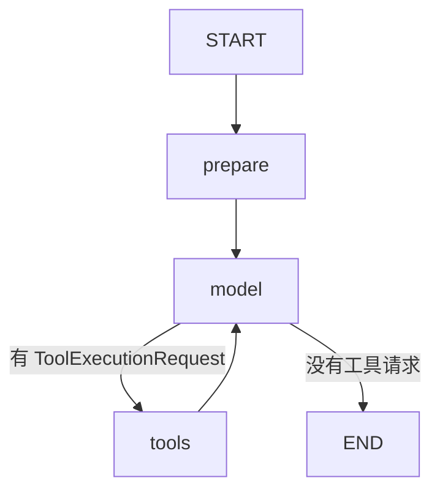

# 12 · 模型与工具：真实协议，默认离线执行

本课用 LangChain4j `ChatModel`、工具请求和工具结果消息完成加法闭环。
默认 `OfflineArithmeticChatModel` 是确定性的本地实现，不进行远程大模型推理。
“协议真实”不等于“默认接入了云模型”；切换真实供应商必须另行显式配置。

源码入口：[模型工具图](#图与工具)、[离线模型](#离线协议模型)、[模型配置](#真实客户端配置)。

## 学习目标

- 跟踪 UserMessage → 工具请求 → 工具结果 → 最终 AiMessage。
- 用原生 `LC4jToolService` 执行工具，不用字符串伪造工具结果。
- 为消息状态使用官方 `LC4jStateSerializer`。
- 同时限制输入范围、工具参数和模型轮数。

## 原生拓扑



`model` 可以被多次访问，但本地默认模型只需要两次。
首次返回 add 工具请求；tools 执行后，第二次 model 读取工具结果形成回答。
原生 Mermaid 文本可查询，本站不要求 Mermaid 渲染插件：

```bash
curl -sS http://127.0.0.1:8099/api/demos/demo12/graph
```

## 状态契约

| 字段 | 输入/初值 | 更新方式 | 离线默认结果 |
|---|---|---|---|
| `a`、`b` | 19、23，整数 -1000..1000 | 只读 | 19、23 |
| `messages` | 默认空列表 | 保留重复地追加消息 | 4 条协议消息 |
| `modelTurns` | prepare 写 0 | 每次模型调用写旧值 + 1 | 2 |
| `modelMode` | prepare 判断注入模型类型 | 替换 | `offline-deterministic` |
| `answer` | 无 | 无工具请求时写文本 | `离线工具结果：42` |

`messages` 使用 `appenderWithDuplicate`，不能为“去重”而删除重复对话内容。
`modelTurns` 是替换型计数，不能误用 sum 的增量规则。
`answer` 只在模型不再请求工具时写入，不是工具节点直接写的。

## 源码中的三个关键点

建图使用专用序列化器，而不是假设 ChatMessage 都是普通 Serializable：

```java
new StateGraph<>(LearningState.SCHEMA,
    new LC4jStateSerializer<>(LearningState::new))
```

模型调用同时收到完整消息历史和工具规格：

```java
model.chat(ChatRequest.builder()
    .messages(s.<ChatMessage>list("messages"))
    .toolSpecifications(tools.toolSpecifications()).build())
```

工具节点取最后一个 AiMessage 的请求，先核对工具名是否在规格列表中，
未知工具立即抛错；合法名称再交给 `LC4jToolService.execute(...)`。
返回 command 的 update 交给图合并到 `messages`，不是手工伪造结果消息。
`ArithmeticTools.add` 使用 `@Tool` 暴露能力，再次检查两个参数都在 -1000..1000。
即使输入已校验，也不能信任真实模型生成的工具参数自动合法。

## 默认请求与确定性输出

```bash
curl -sS -X POST http://127.0.0.1:8099/api/demos/demo12/run \
  -H 'Content-Type: application/json' \
  -d '{"input":{"a":19,"b":23}}'
```

`run` 合并样例默认值；只提交 `a` 时，`b` 仍默认为 23。
在默认离线配置下，响应稳定子集：

```json
{
  "demoId": "demo12",
  "status": "COMPLETED",
  "state": {
    "answer": "离线工具结果：42",
    "modelMode": "offline-deterministic",
    "modelTurns": 2
  }
}
```

业务访问序列为 `prepare → model → tools → model`。
协议消息序列可从源码与测试确认，不依赖 HTTP 把 Java 消息序列化成何种外形：

1. UserMessage：`请调用 add 计算 19 + 23`。
2. AiMessage：请求 `add`，参数为 a=19、b=23。
3. ToolExecutionResultMessage：文本 `42`。
4. AiMessage：`离线工具结果：42`。

离线模型通过正则识别受控格式，不是通用中文理解器。
工具请求 ID `offline-add-1` 是协议关联标签，不是 executionId。

## 单独配置真实模型

以下变量来自 `application.yml`，模型构造与校验来自 `ModelConfiguration`：

| 环境变量 | 映射属性 | 要求 |
|---|---|---|
| `TEACHING_MODEL_PROVIDER` | teaching.model.provider | 默认 offline；真实客户端选 openai |
| `TEACHING_MODEL_API_KEY` | teaching.model.api-key | openai 模式非空，仅由本地安全环境提供 |
| `TEACHING_MODEL_BASE_URL` | teaching.model.base-url | 有 host、不含 userInfo 的 HTTPS 地址；HTTP 仅允许精确回环主机 |
| `TEACHING_MODEL_NAME` | teaching.model.model | 非空，供应商实际支持工具调用的模型名 |

不要误写成 `TEACHING_MODEL_MODEL`；资源配置使用的是 `TEACHING_MODEL_NAME`。
不要把密钥写进本页、Git、curl 请求或截图；模型凭据不是 run 的输入字段。
真实模式需重启应用使配置生效，provider 只允许 `offline` 或 `openai`。
只设置密钥不会切换模式；缺少任何必需配置会在创建模型时失败。
HTTP 例外仅限 `localhost`、`127.0.0.1`、`[::1]`，可带开发服务端口。
`localhost.example.invalid`、`127.0.0.2`、`localhost.` 都不属于这份精确白名单。
远程地址必须 HTTPS；URL 中不能包含用户名或密码，密钥通过独立配置传入。

客户端固定 `temperature(0.0)`、单次超时 30 秒、`maxRetries(0)`，关闭请求与响应日志。
temperature 为 0 也不构成远程结果完全确定的保证。
最多允许 6 次模型调用；准备第 7 次时抛出上限异常，不再请求模型。
这个轮数上限不是整次执行的统一 30 秒超时，也不自动提供费用上限。
真实模式状态标记为 `openai-compatible`，不能再断言固定文本或必定两轮。

## 实验与预期答案

离线输入 `{"input":{"a":9,"b":8}}`，预期回答 `离线工具结果：17`，仍是 4 条消息、2 轮模型。
这是 `ModelIntegrationTest` 检查的协议链，而不只是检查字符串中出现 17。
输入 `a=-1000,b=1000`，预期回答 `离线工具结果：0`。
输入 `a=1001` 或小数，不能正常完成受控加法；工具本身也有独立参数校验。

思考：模型一直请求工具会怎样？
答案：图通过回边继续，但受到 6 轮上限约束，不会无限调用。
本课没有对未知工具、恶意参数或远程失败提供通用自动修复策略。

## 陷阱与能力边界

- 离线模型实现真实 ChatModel 接口，但不代表进行真实远程推理。
- `@Tool` 不是授权系统；新增外部副作用工具需要权限、审计与幂等控制。
- base URL 格式校验不是完整的网络出口安全策略，配置应由可信运维控制。
- `MemorySaver` 仍是进程内保存，消息可序列化不等于已经持久化。
- 不要把此处的非流式 `chat` 宣称为 Token SSE；第 11 课也只提供节点流。

## 课程源码

[图与工具](#图与工具)、[离线协议模型](#离线协议模型)、[真实客户端配置](#真实客户端配置)共同构成完整证据。

### 图与工具

<<< ../../src/main/java/com/xb/langgraph/demo12/ModelToolLoopDemo.java

### 离线协议模型

<<< ../../src/main/java/com/xb/langgraph/demo12/OfflineArithmeticChatModel.java

### 真实客户端配置

<<< ../../src/main/java/com/xb/langgraph/demo12/ModelConfiguration.java

环境变量映射直接来自应用资源文件：

<<< ../../src/main/resources/application.yml

继续阅读[有界重试](./13-retry)，区分模型供应商重试和应用状态驱动的重试。
