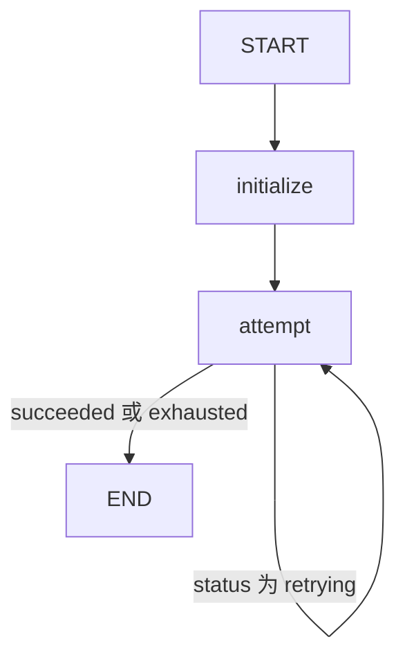

# 13 · 有界重试：把失败分类，把次数留在状态中

本课把暂时性失败转换成业务状态，再由条件边决定是否再试一次。
这是应用层重试示例，不是宣称图引擎会自动重试所有失败节点。
操作完全离线模拟，没有网络请求、等待退避或外部写入。

源码入口：[BoundedRetryDemo 与完整实现](#课程源码)。

## 学习目标

- 只捕获明确允许重试的异常类型。
- 解释最大尝试次数与失败次数的关系。
- 用回边和状态组成可观察的重试流程。
- 区分重试耗尽的业务结果与未处理异常导致的执行失败。

## 原生拓扑



没有独立的成功节点、失败节点或等待节点。
`attempt` 返回业务状态，条件边只检查是否还应继续。
原生 Mermaid 文本：

```bash
curl -sS http://127.0.0.1:8099/api/demos/demo13/graph
```

本页 Mermaid 围栏可以作为源文本阅读。

## 状态输入与更新

| 字段 | 初始来源 | 每次更新 | 默认最终值 |
|---|---|---|---|
| `failuresBeforeSuccess` | 输入 2，范围 0..10 | 不变 | 2 |
| `attempts` | initialize 写 0 | attempt 写旧值 + 1 | 3 |
| `status` | 首次 attempt 产生 | retrying / succeeded / exhausted | succeeded |
| `lastError` | 首次 attempt 产生 | 失败写消息，成功清空 | 空字符串 |
| `trace` | 保留重复的追加列表 | 每轮新增 `attempt:N` | 1、2、3 三次记录 |

`attempts` 是本次执行状态，不是单例服务字段。
新建一次执行会重新初始化为 0，不会接着上一请求的尝试次数继续。
`trace` 用追加器，节点每次只返回本轮一条记录。

## 三次尝试如何计算

`MAX_ATTEMPTS = 3`。
模拟规则是：当 `attempt <= failuresBeforeSuccess` 时抛出 `TransientFailure`。
默认前两次失败，因此第三次成功。

```java
catch (TransientFailure e) {
    return Map.of("attempts", attempt,
        "status", attempt < MAX_ATTEMPTS ? "retrying" : "exhausted",
        "lastError", e.getMessage(),
        "trace", List.of("attempt:" + attempt));
}
```

只捕获自定义暂时性失败，不把任意 RuntimeException 都吞掉。
输入校验失败等问题不是“再试几遍就好”的情况。
`lastError` 成功时写空串；内部 `text("lastError")` 只检查字符串类型，因此允许读取空串。
不要对内部错误结果调用外部输入校验器 `inputText()`，它要求非空且最多 2000 字符。

## 默认请求与结果

```bash
curl -sS -X POST http://127.0.0.1:8099/api/demos/demo13/run \
  -H 'Content-Type: application/json' \
  -d '{"input":{"failuresBeforeSuccess":2}}'
```

空输入对象会补入默认的 2。
稳定响应子集：

```json
{
  "demoId": "demo13",
  "status": "COMPLETED",
  "state": {
    "attempts": 3,
    "status": "succeeded",
    "lastError": "",
    "trace": ["attempt:1", "attempt:2", "attempt:3"]
  }
}
```

业务节点路径是 `initialize → attempt → attempt → attempt`。
最终尝试次数为 3 不等于发生过 3 次失败；默认是失败两次、成功一次。

## 实验：成功边界与耗尽边界

分别提交 0、1、2、3、10，预测结果后再运行。

| failuresBeforeSuccess | attempts | state.status | 原因 |
|---|---|---|---|
| 0 | 1 | succeeded | 首次即可成功 |
| 1 | 2 | succeeded | 一次失败后成功 |
| 2 | 3 | succeeded | 最后允许的一次成功 |
| 3 | 3 | exhausted | 三次全失败，不再尝试第四次 |
| 10 | 3 | exhausted | 输入允许 10，不代表允许重试 10 次 |

耗尽时 `lastError` 为 `离线模拟暂时性失败`。
顶层仍可为 `COMPLETED`，因为异常已被业务代码转为 `exhausted` 并正常到达 END。
这与未处理异常的 `FAILED` 不同。

再次用默认输入新建执行，预期还是从 attempt:1 开始。
测试 `retryIsBoundedAndAttemptsArePerExecution` 检查了两次独立执行和耗尽情况。

## 工程边界与陷阱

- 本例没有指数退避、随机抖动或服务器 Retry-After 处理。
- 不要把紧密回边直接用于会持续失败的真实依赖，否则会增加下游压力。
- 真正外部操作需区分“未执行”与“已执行但响应丢失”，后者需要幂等键。
- 图状态计数不等于跨进程重试预算；当前 MemorySaver 不能跨重启保留预算。
- `failuresBeforeSuccess` 为负数、字符串、小数或大于 10 均不符合约束。
- 不要在循环中重连到 initialize，否则次数反复清零、上限失效。
- 模型客户端的 `maxRetries(0)` 与本课 MAX_ATTEMPTS 是不同层的策略，不能混算。

## 课程源码

源码路径：`src/main/java/com/xb/langgraph/demo13/BoundedRetryDemo.java`。

<<< ../../src/main/java/com/xb/langgraph/demo13/BoundedRetryDemo.java

下一课学习[幂等与副作用](./14-idempotency)：允许重复尝试时，如何避免状态重复入账。
