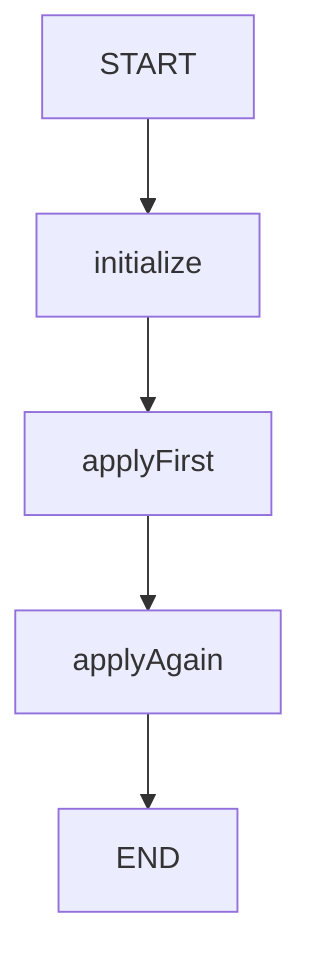

# 14 · 幂等与副作用：调用两次，状态只增加一次

幂等不是不执行第二次，而是重复请求不会重复改变目标结果。
本课故意让两个节点调用同一个入账函数：轨迹记录两次，余额只增加一次。
它只演示状态级防重，不连接数据库、支付网关或账务系统。
初始化会保留已有 balance，而不是每次重新写 initialBalance，避免已有检查点中的余额被重置。

源码入口：[IdempotencyDemo 与完整实现](#课程源码)。

## 学习目标

- 用业务 operationId 判断同一操作是否已应用。
- 分别观察调用次数与余额变化次数。
- 区分去重列表和防重判断的不同职责。
- 说明为什么本例不能提供跨进程 exactly-once。

## 原生拓扑



两次调用是顺序执行，不存在并行竞争。
`applyAgain` 不是空节点，它仍调用同一个 `apply` 方法并写一条轨迹。
原生 Mermaid 可查询，站点不依赖 Mermaid 渲染：

```bash
curl -sS http://127.0.0.1:8099/api/demos/demo14/graph
```

## 输入、状态与默认结果

| 字段 | 默认值/来源 | 更新逻辑 | 最终值 |
|---|---|---|---|
| `operationId` | 输入 `order-1` | 清理后用于判断 | 原始输入保留 |
| `initialBalance` | 输入 100，范围 0..1000000 | initialize 读取 | 100 |
| `amount` | 输入 10，范围 1..100000 | apply 读取 | 10 |
| `balance` | initialize 仅在尚无余额时写初始值 | 首次入账写新总额 | 110 |
| `appliedOperations` | 去重追加空列表 | 首次记录 operationId | `["order-1"]` |
| `trace` | 保留重复追加空列表 | 每次调用记录 apply | 两个相同元素 |

`balance` 采用替换语义，代码算好新余额再返回。
`appliedOperations` 用 appender 去重，但不能仅靠这个 Reducer 实现余额防重。
真正阻止重复加钱的是入账前的 `contains(operation)` 判断。

## 阅读共享 apply 方法

```java
update.put("trace", List.of("apply:" + operation));
if (!s.<String>list("appliedOperations").contains(operation)) {
    update.put("balance", Math.addExact(s.count("balance"),
        s.integer("amount", 1, 100000)));
    update.put("appliedOperations", List.of(operation));
}
```

轨迹写入位于条件之外，因此第二次调用仍留下证据。
余额和已处理标识位于条件之内，只在首次遇到该操作时产生更新。
第二次返回的 Map 不含 balance；这不是清空余额，而是保持原值。

`Math.addExact` 用于防止整数溢出被静默截断。
不过按本课允许的初始余额和单次金额范围，默认正常计算远低于 int 上限。
不能把这段算术保护误认为金融金额建模、货币精度或事务一致性方案。

## 默认运行

```bash
curl -sS -X POST http://127.0.0.1:8099/api/demos/demo14/run \
  -H 'Content-Type: application/json' \
  -d '{"input":{"operationId":"order-1","initialBalance":100,"amount":10}}'
```

HTTP 会合并默认字段，但不要从输入注入 balance 或 appliedOperations。
响应确定性子集：

```json
{
  "demoId": "demo14",
  "status": "COMPLETED",
  "state": {
    "balance": 110,
    "appliedOperations": ["order-1"],
    "trace": ["apply:order-1", "apply:order-1"]
  }
}
```

业务路径为 `initialize → applyFirst → applyAgain`。
余额不是 120，轨迹也不是一条；两个断言必须同时满足，才能证明演示目标。

## 实验一：新的余额与金额

提交 `{"input":{"operationId":"expense-7","initialBalance":200,"amount":25}}`。
预期 balance 为 225，已处理列表只有 expense-7，轨迹包含两次 apply:expense-7。
如果余额是 250，说明重复检查没有阻止第二次更新。
如果轨迹只有一项，可能误用了去重追加器，掩盖了真实尝试次数。

## 实验二：同一 operationId 再创建一次执行

用相同请求再调一次 run，记录两次响应各自真实的 executionId。
预期两次各自最终余额都是 225，不会自动串成同一外部账户余额。
原因是每次执行从自己的初始余额与操作记录开始。
此实验不证明跨请求去重成功，反而揭示了状态级幂等的作用域。

原生层还有另一种实验：复用同一编译图、saver 和 threadId，以 `GraphInput.args` 再次提交业务输入。
默认 order-1 首次得到 110，再次 order-1 仍为 110；换 order-2、amount=7 后为 117，再次 order-2 仍为 117。
`idempotencyPreservesRetainedBalanceAndCreditsEachNewOperationOnce` 验证这组保留状态行为。
这不是 HTTP resume 接口：本课没有待审节点，HTTP 也不开放指定旧 threadId 重跑的入口。
已有余额不免除校验，initialize 仍检查 operationId、amount 和 initialBalance 的合法性。

## 为什么不是数据库级 exactly-once

当前检查和写入只发生在一条顺序图的共享状态里。
如果两个外部请求并发检查数据库后同时写入，单靠 `contains` 无法避免竞争。
如果真实付款已经成功，但检查点还没写入就宕机，恢复可能再次付款。

生产设计通常还需业务唯一键、原子事务或下游幂等协议，
并明确“已受理”“已执行”“已确认”这些状态的恢复规则。
本课没有实现这些机制，因此不能把演示输出升级为支付保证。

## 输入边界与陷阱

- operationId 必须是非空字符串，最多 2000 字符；比较使用 inputText() 清理后的值。
- `amount=0`、负数或超过 100000 都不符合本课入账约束。
- 不支持扣款、退款、负余额或多币种。
- 不要把 trace 去重当作“消除了重复副作用”。
- MemorySaver 是进程内存；保存过标识不等于跨重启仍然可见。
- 把两次 apply 改成并行后必须重新审查原子性，不能照搬顺序推理。

## 课程源码

源码路径：`src/main/java/com/xb/langgraph/demo14/IdempotencyDemo.java`。

<<< ../../src/main/java/com/xb/langgraph/demo14/IdempotencyDemo.java

测试 `idempotencyKeepsBothAttemptsButOnlyOneBalanceChange` 同时检查轨迹、标识和余额。
继续阅读[可观测性](./15-observability)，把执行路径与实际测量结合起来。
