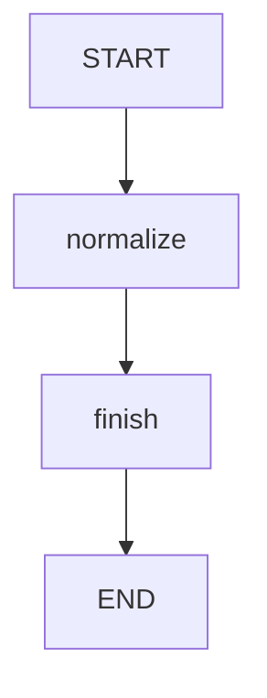

# 15 · 可观测性：测量真实节点，而不是填写示例耗时

本课给节点动作加一层计时包装，同时记录业务轨迹。
测量值来自 `System.nanoTime()` 的差值，不是固定常量，也不是通过 sleep 伪造。
默认业务仍是把主题转换为大写，便于把正确性和耗时观察分开。

源码入口：[NodeTimingDemo 与完整实现](#课程源码)。

## 学习目标

- 用 NodeAction 包装器统一加入计时与轨迹更新。
- 理解嵌套 Map 合并为何需要自定义 Reducer。
- 对动态数值写性质断言，不抄一份固定纳秒数。
- 区分节点动作耗时与端到端 HTTP 延迟。

## 原生拓扑



`timed` 是动作包装器，不是第三个节点。
图拓扑仍只有 normalize 和 finish，包装不会改变控制流。
原生 Mermaid 文本：

```bash
curl -sS http://127.0.0.1:8099/api/demos/demo15/graph
```

站点没有 Mermaid 插件也可以阅读以上围栏。

## 状态契约

| 字段 | 输入/初始值 | 更新来源 | 默认结果或性质 |
|---|---|---|---|
| `topic` | `LangGraph4j` | 只读 | 保留 |
| `normalized` | 无 | normalize | `LANGGRAPH4J` |
| `result` | 无 | finish | `LANGGRAPH4J` |
| `trace` | 保留重复追加空列表 | timed 包装器 | `["normalize","finish"]` |
| `timingsNanos` | 默认空 Map | 每个节点提交一个键 | 两个非负纳秒值 |

`timingsNanos` 不是自动深度合并所有 Map。
共享 schema 明确创建旧 Map 的副本，再对本次 update 执行 `putAll`。
因此 normalize 的记录不会被 finish 的单键 Map 整体覆盖。

## 包装器具体测量了什么

```java
long started = System.nanoTime();
Map<String,Object> update = new HashMap<>(action.apply(state));
long elapsed = System.nanoTime() - started;
update.put("timingsNanos", Map.of(name, elapsed));
update.put("trace", List.of(name));
return update;
```

计时覆盖动作调用与创建更新 Map 副本，结束于写入指标之前。
不覆盖之后的 Channel 合并、检查点保存、HTTP 序列化与网络传输。
`nanoTime()` 的差值适合测量持续时间，不是可展示成日期的时间戳。

节点返回的原始 Map 可能来自不可变的 `Map.of`。
先复制到 HashMap，才能安全添加 `timingsNanos` 和 `trace`。
这也避免了包装器直接修改业务动作原来持有的 Map。

## 默认请求

```bash
curl -sS -X POST http://127.0.0.1:8099/api/demos/demo15/run \
  -H 'Content-Type: application/json' \
  -d '{"input":{"topic":"LangGraph4j"}}'
```

空输入对象会合并默认主题。
下面只列确定性的字段，不编造测量值：

```json
{
  "demoId": "demo15",
  "status": "COMPLETED",
  "state": {
    "normalized": "LANGGRAPH4J",
    "result": "LANGGRAPH4J",
    "trace": ["normalize", "finish"]
  }
}
```

另行检查 `state.timingsNanos` 含 normalize 和 finish 两个键，值都是非负数。
`visitedNodes` 的业务顺序与 trace 对应，但它来自执行层，不是同一份字段。
计时精度不等于分辨率；不要要求每次结果严格大于零。

## 实验：重复请求，哪些值应该稳定？

连续创建三次相同输入的执行，不要求三次纳秒值相同。
预期 result 与 trace 相同；timingsNanos 可能变化。
JIT、调度、CPU 缓存及测量开销都可能影响短动作的观测值。

现有测试 `timingUsesRealNonnegativeMeasurementsAndTrace` 只检查：

1. 两条轨迹。
2. 计时 Map 有两个键。
3. 所有计时非负。
4. 业务结果为 `LANGGRAPH4J`。

它没有声称某节点必须比另一个快，也没有给机器无关的性能阈值。

## 进阶实验：循环节点会记录几次耗时？

在纸上推演：同一个节点名先记录 100，再记录 200，Reducer 最终保存什么？
答案：该键保留 200，因为 `putAll` 对相同键使用后值替换。
trace 使用保留重复追加器，仍可以出现两次相同节点名。
所以这个计时结构记录“每个名字最后一次耗时”，不是每次调用的耗时分布。

如果需要平均值、分位数、调用总次数，应设计新的指标结构或接入指标系统。
不能从当前两个数字反推出完整延迟分布。

## 故障与能力边界

- 包装器没有 finally；若 `action.apply` 抛异常，本次计时与轨迹更新不会返回。
- 因而本课不是完整的失败可观测性方案，不要声称失败节点也一定有耗时。
- 计时总和不等于 HTTP 总耗时，尤其并行图不能简单相加解释墙钟时间。
- 本例没有 OpenTelemetry、分布式追踪、日志脱敏或指标后端。
- 外部 topic 受 1..2000 字符限制；finish 的 text() 只校验类型，允许大写转换后的文本变长。
- 当前 MemorySaver 不能替代长期指标存储，重启会失去内存执行记录。

## 课程源码

源码路径：`src/main/java/com/xb/langgraph/demo15/NodeTimingDemo.java`。

<<< ../../src/main/java/com/xb/langgraph/demo15/NodeTimingDemo.java

合并规则参见[状态课](./03-state#共享合并规则)。
下一课把分支、起草和审核连起来：[工单处理](./16-ticket)。
