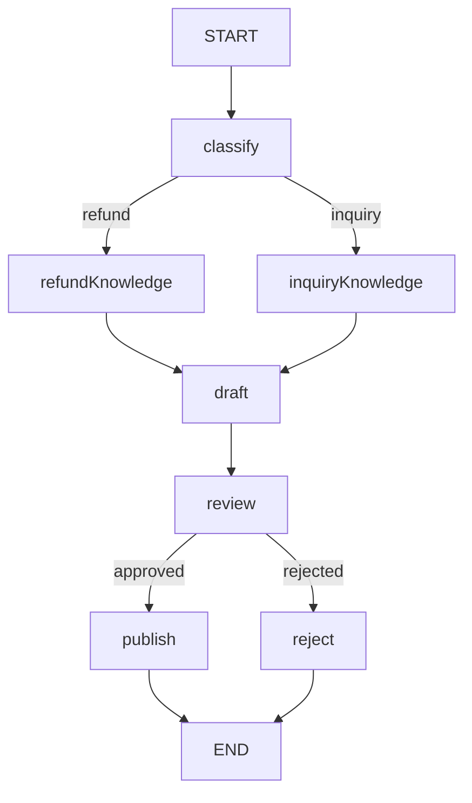

# 16 · 工单处理：分类、知识选择、起草与审核

本课把条件分支与人工中断组合成一个完整客服流程。
分类依赖本地关键词，知识是固定教学字符串，不是向量检索或真实售后政策。
审核前只有草稿；只有同意后才进入 publish 产生 reply。

源码入口：[TicketWorkflowDemo 与完整实现](#课程源码)。

## 学习目标

- 验证不同分类确实访问不同知识节点。
- 理解多路分支汇入起草节点与并行汇合的区别。
- 用人工审核阻止未经确认的回复进入发布状态。
- 识别离线规则、实际客服制度与真正外部发送的边界。

## 原生拓扑



分类分支互斥，不是同时执行两种知识查询。
进入 `review` 前暂停；审核节点本身恢复后才执行。
原生 Mermaid 文本如下，本页围栏不要求渲染插件：

```bash
curl -sS http://127.0.0.1:8099/api/demos/demo16/graph
```

## 状态契约

| 字段 | 来源 | 暂停时默认值 | 最终变化 |
|---|---|---|---|
| `ticket` | 输入 `收到商品后想申请退款` | 原文保留 | 不变 |
| `category` | classify | refund | 不变 |
| `dataMode` | classify | offline-rules | 不变 |
| `knowledge` | 所选知识节点 | 退款政策文本 | 不变 |
| `draft` | draft | 您好，加知识文本 | 不变 |
| `approved` | resume 映射 | 尚未提供 | true 或 false |
| `status` | draft / review / 后继 | pending | published 或 rejected |
| `reply` | publish | 尚不存在 | 同意后等于 draft；拒绝时不产生 |

知识文本与草稿默认值分别是：

- `退款政策：7天内可申请退款（离线规则）。`
- `您好，退款政策：7天内可申请退款（离线规则）。`

这些是教学样本，不能引用为真实商家的退款承诺。

## 源码中的数据与控制流

`classify` 读取 ticket，只检查是否包含字面关键词 `退款`。
包含就写 refund，否则写 inquiry，并注明 `offline-rules`。
条件边返回 category，再映射到对应知识节点。

```java
.addNode("review", node_async(s -> Map.of("status",
    s.decision("approved") ? "approved" : "rejected")))
.addNode("publish", node_async(s -> Map.of(
    "reply", s.text("draft"), "status", "published")))
```

审核通过不是直接结束：它先产生 approved，再经条件边进入 publish。
拒绝进入 reject，不生成 reply。
当前 publish 只是更新状态，没有向用户发送邮件或调用客服平台。

## 第一步：运行默认退款工单

```bash
curl -sS -X POST http://127.0.0.1:8099/api/demos/demo16/run \
  -H 'Content-Type: application/json' \
  -d '{"input":{"ticket":"收到商品后想申请退款"}}'
```

HTTP 合并样例默认字段。暂停响应的稳定子集：

```json
{
  "demoId": "demo16",
  "status": "WAITING_REVIEW",
  "pendingNode": "review",
  "state": {
    "category": "refund",
    "dataMode": "offline-rules",
    "knowledge": "退款政策：7天内可申请退款（离线规则）。",
    "draft": "您好，退款政策：7天内可申请退款（离线规则）。",
    "status": "pending"
  }
}
```

业务路径此时为 `classify → refundKnowledge → draft`。
不应包含 inquiryKnowledge，也不应声称 reply 已发布。

## 第二步：审核后发布

```bash
EXECUTION_ID='替换为本次 run 返回的 executionId'
curl -sS -X POST "http://127.0.0.1:8099/api/executions/$EXECUTION_ID/resume" \
  -H 'Content-Type: application/json' -d '{"approved":true}'
curl -sS "http://127.0.0.1:8099/api/executions/$EXECUTION_ID/history"
```

只发送当前审核决定，不发送 `category`、`status` 或 `reply` 等内部字段。
预期顶层 `status=COMPLETED`，业务 `state.status=published`，
`reply=您好，退款政策：7天内可申请退款（离线规则）。`。
后续业务路径为 `review → publish`，不应重新分类或再次起草。

## 实验一：咨询路线

新建执行，输入 `{"input":{"ticket":"如何查看物流？"}}`。
预期 category 为 inquiry，访问 inquiryKnowledge 而不是 refundKnowledge。
知识为 `咨询政策：在订单页面查看物流（离线规则）。`，
草稿为 `您好，咨询政策：在订单页面查看物流（离线规则）。`。
审核同意后 reply 等于这份草稿。

## 实验二：拒绝与关键词局限

新建默认工单，用新的真实 executionId 提交 `{"approved":false}`。
预期顶层 COMPLETED、业务 rejected，且没有 publish 产生的 reply。
拒绝是正常业务终态，不是 FAILED。

再输入 `我不想退款，只想问物流`。
预期仍是 refund，因为代码只看是否包含关键词，不理解否定语义。
这正是本地规则的边界；不能把结果描述为“模型理解了用户意图”。

## 边界与工程提醒

- ticket 必须为非空字符串，最多 2000 字符；不支持附件和多语言分类模型。
- draft 在审核前保留，便于人工查看；拒绝不自动删除草稿或知识证据。
- resume 使用 `GraphInput.resume()`，不是重发原始 run 请求。
- review 中断依赖 saver；当前 MemorySaver 不能跨服务重启保存待审核工单。
- 身份认证、审核角色、真实消息发送、发送幂等和失败补偿都需业务系统另行实现。
- 不要向 run 注入 approved 绕过审核，也不要把 resume 当任意状态修改接口。

## 课程源码

源码路径：`src/main/java/com/xb/langgraph/demo16/TicketWorkflowDemo.java`。

<<< ../../src/main/java/com/xb/langgraph/demo16/TicketWorkflowDemo.java

测试 `ticketUsesCategorySpecificKnowledgeAndPublishesOnlyAfterApproval` 覆盖两类知识与同意、拒绝。
继续阅读[多级费用审批](./17-expense)，观察一个执行连续等待两次审核。
