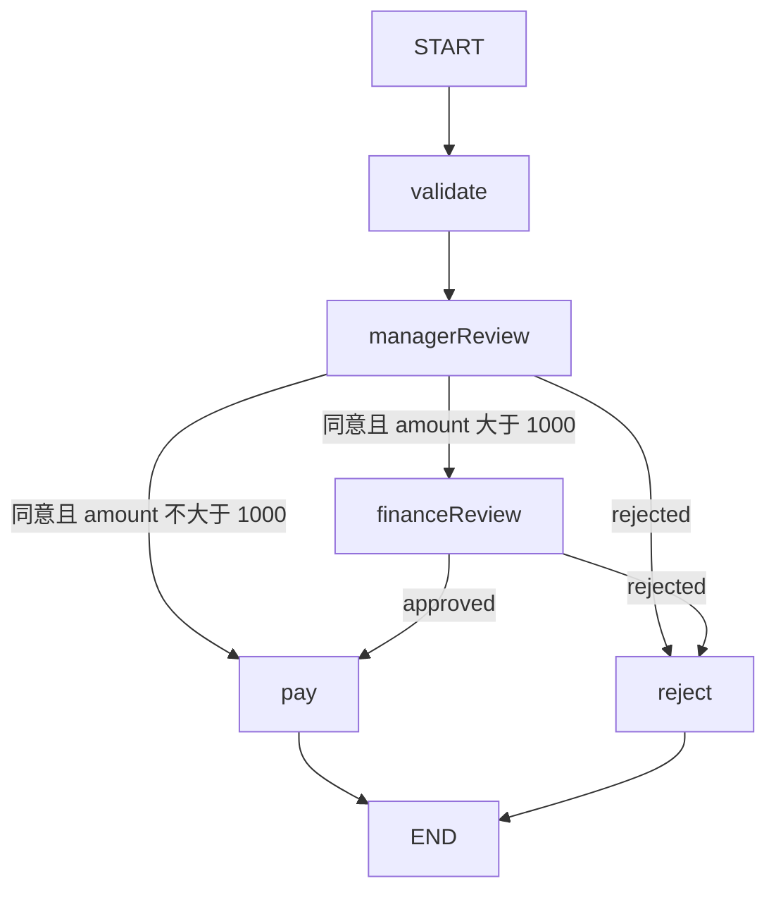

# 17 · 多级费用审批：同一执行，两次独立审核

本课最重要的不是金额判断，而是两次恢复必须针对当前待处理节点。
所有报销先经经理审核；金额严格大于 1000 且经理同意后，还要等待财务审核。
付款只是本地状态模拟，不涉及真实账户或资金转移。

源码入口：[ExpenseApprovalDemo 与完整实现](#边界与课程源码)。

## 学习目标

- 根据金额与经理意见推导是否需要第二级审核。
- 每次从同一执行的最新检查点恢复，不重复使用旧历史位置。
- 理解统一 HTTP `approved` 如何映射到不同内部状态键。
- 检查拒绝路径永远不会产生已付款结果。

## 原生拓扑



`managerReview` 与 `financeReview` 都配置为执行前中断。
低金额路径不会到达财务节点，也不会多产生一次待审核。
原生 Mermaid 以接口为准，本页围栏允许文本阅读：

```bash
curl -sS http://127.0.0.1:8099/api/demos/demo17/graph
```

## 状态输入、更新与输出

| 字段 | 来源/默认 | 更新时机 | 含义 |
|---|---|---|---|
| `amount` | 整数 1500，范围 1..1000000 | 输入后只读 | 教学金额，不含币种模型 |
| `status` | validate 写 pending_manager | 每级节点替换 | pending_manager / pending_finance / paid / rejected 等 |
| `managerApproved` | 当前经理审核的 resume 映射 | 第一次恢复前 | 经理布尔意见 |
| `financeApproved` | 当前财务审核的 resume 映射 | 需要时第二次恢复前 | 财务布尔意见 |
| `paid` | pay 或 reject | 最后一步 | true 或 false |
| `paymentMode` | pay | 仅付款路径 | offline-simulation |

初次暂停时 paid 尚未写入，不要把字段缺失解读为已付款。
拒绝节点明确写 `paid=false`；付款节点写 `paid=true`。
业务状态 `approved` 是通往 pay 的中间状态，最后结果是 `paid`。

## 源码里的关键分流

```java
.addNode("managerReview", node_async(s -> Map.of("status",
    !s.decision("managerApproved") ? "rejected" :
    s.count("amount") > 1000 ? "pending_finance" : "approved")))
```

先判断经理是否拒绝，再判断金额。
因此即使是高金额，经理拒绝也立即进入 reject，不会再询问财务。
阈值是 `> 1000`，不是 `>= 1000`。
财务节点独立读取 financeApproved，不复用经理的布尔值。

## 第一步：提交默认高金额报销

```bash
curl -sS -X POST http://127.0.0.1:8099/api/demos/demo17/run \
  -H 'Content-Type: application/json' -d '{"input":{"amount":1500}}'
```

HTTP 会补入省略的默认字段。确定性暂停子集：

```json
{
  "demoId": "demo17",
  "status": "WAITING_REVIEW",
  "pendingNode": "managerReview",
  "state": {"amount": 1500, "status": "pending_manager"}
}
```

此时只有 validate 已完成业务处理。
保存服务实际返回的 executionId；下面所有请求都使用这一个 ID。

## 第二步：经理同意，仍未完成

```bash
EXECUTION_ID='替换为本次 run 返回的 executionId'
curl -sS -X POST "http://127.0.0.1:8099/api/executions/$EXECUTION_ID/resume" \
  -H 'Content-Type: application/json' -d '{"approved":true}'
```

运行层看到当前 pendingNode 是 managerReview，将决定写入 managerApproved。
预期响应为：

```json
{
  "status": "WAITING_REVIEW",
  "pendingNode": "financeReview",
  "state": {"managerApproved": true, "status": "pending_finance"}
}
```

经理审核完成不等于这张图完成，也不等于财务已经批准。
一定先查看这次响应的 pendingNode，再决定下一次审核操作。

## 第三步：财务同意，结束付款模拟

```bash
curl -sS -X POST "http://127.0.0.1:8099/api/executions/$EXECUTION_ID/resume" \
  -H 'Content-Type: application/json' -d '{"approved":true}'
curl -sS "http://127.0.0.1:8099/api/executions/$EXECUTION_ID/history"
```

请求外形完全相同，但这次运行层只把决定映射给 financeApproved。
预期顶层 `COMPLETED`，最终业务子集：

```json
{
  "status": "paid",
  "paid": true,
  "paymentMode": "offline-simulation",
  "managerApproved": true,
  "financeApproved": true
}
```

上面展示的是 `state` 内的子集，不是整个 HTTP 响应。
合并业务路径是 `validate → managerReview → financeReview → pay`。
第二次恢复不应重新运行 validate 或 managerReview。

## 恢复配置为什么容易用错

原生步骤是 `updateState` 写当前决定，再以同一 threadId 最新配置执行 `GraphInput.resume()`。
不要在两级审核中一直复用第一次暂停的历史 checkpoint config。
那会把恢复锚定到旧位置，而不是当前财务审核位置。
也不要用第三参数 `asNode` 假装“指定下一个节点”，否则可能跳过真实审核动作。

HTTP 客户端只发 `{"approved":true/false}`。
不能发 `managerApproved`、`financeApproved`、`paid`、`status` 或任意状态注入。
内部键属于服务映射职责，不属于客户端提前批准两个阶段的接口。

## 实验矩阵与预期答案

每行都重新 run，使用该次返回的真实 ID，不要复用已完成执行。

| 金额 | 经理 | 财务 | 需要 resume 次数 | 最终业务结果 |
|---|---|---|---|---|
| 500 | 同意 | 不需要 | 1 | paid，paid=true |
| 1000 | 同意 | 不需要 | 1 | paid，验证严格阈值 |
| 1001 | 同意 | 同意 | 2 | paid |
| 1500 | 拒绝 | 不会询问 | 1 | rejected，paid=false |
| 1500 | 同意 | 拒绝 | 2 | rejected，paid=false |

拒绝的顶层仍是 COMPLETED，不是 FAILED。
非法金额 0、小数、字符串或大于 1000000 不应进入正常审批。

## 边界与课程源码

本例没有真实支付、角色认证、双人复核身份校验或数据库事务。
MemorySaver 仅进程内保存；生产审批需要持久化、并发提交控制及审计。
不要把同一个人连续 curl 两次当作已经证明经理与财务权限隔离。

源码路径：[ExpenseApprovalDemo.java](../../src/main/java/com/xb/langgraph/demo17/ExpenseApprovalDemo.java)。

<<< ../../src/main/java/com/xb/langgraph/demo17/ExpenseApprovalDemo.java

测试 `expenseHasSeparateManagerAndFinanceInterruptions` 覆盖高低金额和两种拒绝位置。
最后一课把并行与人工发布结合起来：[研究报告](./18-research)。
