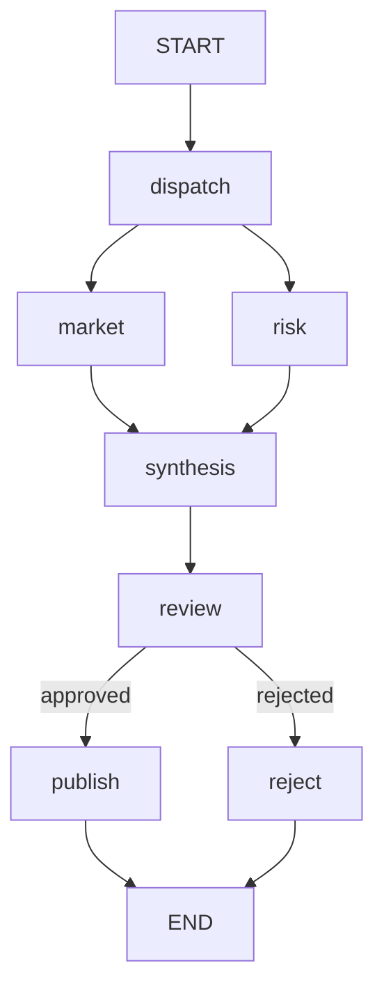

# 18 · 研究报告：并行材料、来源标识与人工发布

本课综合并行、状态合并、审核中断和条件发布。
默认材料是两段固定本地教学资料，不是实时检索、市场预测或投资建议。
报告会保留来源标识，但这些标识不是已验证的网页链接或外部文献引用。

源码入口：[ResearchWorkflowDemo 与完整实现](#课程源码)。

## 学习目标

- 用显式执行器并行收集两类资料。
- 在汇合节点排序合成，避免把竞态顺序写进报告契约。
- 区分待审 synthesis 与审核后才产生的 report、citations。
- 识别“存在引用标识”和“引用得到外部证据支持”的差别。

## 原生拓扑



market、risk 是并行单步分支，共同汇入 synthesis。
review 执行前暂停，人工决定后才进入 publish 或 reject。
获取原生 Mermaid 文本，或直接阅读本页代码围栏：

```bash
curl -sS http://127.0.0.1:8099/api/demos/demo18/graph
```

## 输入、更新与默认结果

| 字段 | 来源/初值 | 写入节点 | 作用 |
|---|---|---|---|
| `topic` | 输入 `企业AI助手` | 只读 | 报告标题主题 |
| `dataMode` | 无 | dispatch | offline-fixture |
| `facts` | 去重追加空列表 | market、risk 各贡献一项 | 原始教学材料 |
| `synthesis` | 无 | synthesis | 主题加排序后的材料 |
| `status` | synthesis 写 pending | review 与后继替换 | published 或 rejected |
| `approved` | resume 映射 | 恢复前 | 当前审核决定 |
| `report` | 无 | publish | 与 synthesis 相同 |
| `citations` | 无 | publish | market-001、risk-001 |

两条默认事实精确为：

```text
[market-001] 教学资料：企业关注效率提升。
[risk-001] 教学资料：需评估隐私与幻觉风险。
```

事实列表使用 `Channels.appender`，对相等元素去重。
它的数组顺序不是并行完成顺序保证；synthesis 显式排序后再连接。

## 源码中的并行与确定性

```java
RunnableConfig.builder().threadId(threadId)
    .addParallelNodeExecutor("dispatch", ForkJoinPool.commonPool())
    .build();
```

执行器绑定到扇出源 dispatch，`node_async` 本身不能保证同步分支并发。
默认构造器提供固定来源函数，另一个构造器允许替换两个 `Function<String,String>`。
测试借此让两个分支等待共同屏障，证明原生调度确实发生重叠。

合成格式是主题加 `（离线固定资料）`，随后换行列出排序后的事实。
默认材料不随主题变化；主题只是传给来源函数，而默认函数并不使用它来检索。
因此更换标题不能让本地固定资料变成真实研究。

## 第一步：运行并检查待审内容

```bash
curl -sS -X POST http://127.0.0.1:8099/api/demos/demo18/run \
  -H 'Content-Type: application/json' \
  -d '{"input":{"topic":"企业AI助手"}}'
```

HTTP 合并样例默认输入。确定性暂停子集：

```json
{
  "demoId": "demo18",
  "status": "WAITING_REVIEW",
  "pendingNode": "review",
  "state": {
    "dataMode": "offline-fixture",
    "status": "pending",
    "synthesis": "企业AI助手（离线固定资料）\n[market-001] 教学资料：企业关注效率提升。\n[risk-001] 教学资料：需评估隐私与幻觉风险。"
  }
}
```

审核前已经收集和合成材料，但没有 publish 产生的 report 与 citations。
并行输出可能采用组合节点名，不要要求 visitedNodes 固定先 market 后 risk。
应检查两个来源都已贡献到 synthesis，以及 review 尚待执行。

## 第二步：同意发布

```bash
EXECUTION_ID='替换为本次 run 返回的 executionId'
curl -sS -X POST "http://127.0.0.1:8099/api/executions/$EXECUTION_ID/resume" \
  -H 'Content-Type: application/json' -d '{"approved":true}'
curl -sS "http://127.0.0.1:8099/api/executions/$EXECUTION_ID"
```

运行层把 approved 只映射给当前 review，再用 `GraphInput.resume()` 恢复。
完成响应的稳定子集：

```json
{
  "demoId": "demo18",
  "status": "COMPLETED",
  "state": {
    "status": "published",
    "citations": ["market-001", "risk-001"]
  }
}
```

同时检查 report 与之前 synthesis 完全相同。
这里的 publish 仅写状态，不会自动创建文件、发布网站或调用外部内容系统。

## 实验一：拒绝后保留了什么？

重新 run，使用新返回的 executionId 提交 `{"approved":false}`。
预期顶层 COMPLETED，业务状态 rejected；不产生 report 或 citations。
facts 与 synthesis 仍保留，因为 reject 只返回 status 更新，没有清空其他字段。
这让审核者仍可检查被拒绝的材料，但不等于实现了正式审计保留策略。

## 实验二：换主题是否等于重新检索？

输入 `{"input":{"topic":"医疗助手"}}`。
预期 synthesis 首行变成 `医疗助手（离线固定资料）`，两条事实原文不变。
答案说明本例没有网络检索，也没有针对医疗主题生成新证据。
不能把同一套固定材料包装成已经完成领域研究的结论。

## 进阶问题：替换来源函数后引用可靠吗？

构造器允许注入新内容，但 publish 仍硬编码 citations 为 market-001、risk-001。
因此提供者需要遵守源码注释约定，分别保留这两个来源标识。
若替换成没有这些标识的文本，图不会自动验证引用与内容一致。
并发测试替换函数只为了验证动作重叠，不是在验证报告引用质量。

真实系统需要结构化来源、抓取时间、可访问 URL、内容快照与引用校验。
这些能力本课未实现，不能从 `citations` 非空推断已经具备。

## 陷阱与边界

- 原生直接并行分支限制为单步、共同汇合；复杂分支需考虑编译子图封装。
- commonPool 是教学选择，真实阻塞来源调用需要容量、超时与资源隔离设计。
- 一个分支失败时不能把另一侧材料冒充完整报告；本课没有自动降级逻辑。
- 外部 topic 用 inputText() 限制为 1..2000 字符；内部 synthesis 用 text() 读取，允许附加材料后超过 2000。
- MemorySaver 仅进程内保存，服务重启后不能保证恢复待审报告。
- 审核同意不代表事实正确，也不构成专业投资、隐私或合规判断。

## 课程源码

源码路径：[ResearchWorkflowDemo.java](../../src/main/java/com/xb/langgraph/demo18/ResearchWorkflowDemo.java)。

<<< ../../src/main/java/com/xb/langgraph/demo18/ResearchWorkflowDemo.java

`researchUsesExplicitFixturesAndCitationsAfterReview` 检查离线标记、审核与引用。
`ParallelExecutionTest` 验证两分支动作重叠，见[并行课](./06-parallel#并发验证)。
回顾[核心概念](/guide/concepts)，把节点、Channel、执行配置与业务边界分别解释清楚。
